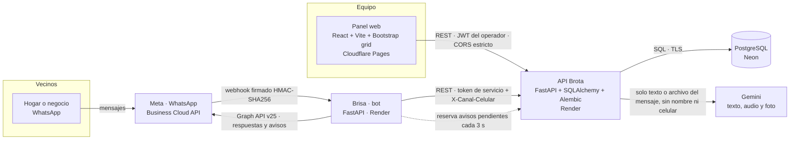

# Brota · EcoConecta Villas de San Pablo

Plataforma para la gestión comunitaria de residuos del piloto **EcoConecta** (Fundación Santo Domingo ·
Universidad Libre) en Villas de San Pablo, Barranquilla. Conecta a los hogares y negocios con los
**huerteros** (orgánicos, Huerta Ecorazón) y los **recicladores** (Asorescatar):

- **Brisa**: asistente de WhatsApp (Cloud API de Meta) para informarse, pedir la recolección y ver su estado.
- **Panel web**: coordinación, recolectores, Fundación y administración.
- **API**: FastAPI, con PostgreSQL como única fuente de verdad.

## Producto publicado

| Pieza | URL | Proveedor |
| --- | --- | --- |
| Panel web (coordinación, recolectores, Fundación, administración) | https://brota-panel.pages.dev | Cloudflare Pages |
| API REST (documentación en `/docs`) | https://brota-api-6bpj.onrender.com | Render (Docker, Virginia) |
| Brisa · webhook de WhatsApp | https://brota-bot.onrender.com/webhook | Render (Docker, Virginia) |
| Base de datos | PostgreSQL 18 administrado (proyecto `brota`, `aws-us-east-1`) | Neon |

Los vecinos usan Brisa por WhatsApp; la guía pública para hogares y negocios está en el mismo panel
(«Guía para hogares y negocios»). Las cuentas de demostración se entregan al jurado aparte: el PIN
inicial vive solo en la variable `SEED_PIN` de Render y no se publica aquí.

## Arquitectura



- **Cómputo:** dos servicios web Docker en Render (`brota-api`, `brota-bot`), declarados en
  [render.yaml](render.yaml). El panel es estático en Cloudflare Pages.
- **Base de datos:** PostgreSQL en Neon con TLS. Al arrancar, la API aplica las migraciones Alembic
  (`MIGRAR_AL_INICIAR`) y la semilla (`SEMBRAR_AL_INICIAR`).
- **Almacenamiento:** no se guardan archivos. Las fotos y audios de WhatsApp se procesan en memoria y
  solo queda su texto.
- **Redes y seguridad:** todo es HTTPS. El webhook de Meta va firmado con el App Secret. La API exige
  JWT para el panel y un token de servicio para el bot, con CORS restringido al dominio del panel. Las
  cabeceras de seguridad van en la API (HSTS, `nosniff`, sin marcos, sin caché en `/v1`) y en el panel (CSP estricta, sin marcos). El inicio de
  sesión frena la fuerza bruta (5 fallos en 15 min bloquean ese usuario).
- **Avisos al vecino:** la API los encola en `evento_salida`; Brisa los reserva, los envía por WhatsApp
  y confirma el resultado (patrón *outbox*, sin pérdidas si el bot se reinicia).

Diagramas y detalle: [docs/despliegue-nube.md](docs/despliegue-nube.md) (infraestructura),
[docs/modelo-de-datos.md](docs/modelo-de-datos.md) (modelo de datos, generado desde el código) y
[docs/diseno-base-de-datos.md](docs/diseno-base-de-datos.md) (decisiones del modelo).

## Cómo cumple el reto

| Requisito | Dónde se ve |
| --- | --- |
| §5.1 Perfiles y permisos | Cuentas con rol `coordinacion` (por colectivo), `huertero`, `reciclador`, `fundacion` y `admin`; el vecino es un `participante` de WhatsApp. Cada endpoint exige su rol (401 sin sesión, 403 con otro rol). |
| §5.2 Educación | Contenidos por tema (separación, huerta, horarios y rutas, servicio), públicos sin sesión en la guía y en Brisa; administración los edita y publica. |
| §5.3 Solicitud | Brisa captura contacto, unidad (dirección), tipo de generador (hogar o negocio), materiales, observación y preferencia horaria; genera el código `BR-…` y un estado consultable («Mis solicitudes»). |
| RN-01 Separación de flujos | Cada material pertenece a un colectivo: orgánicos → Huerta Ecorazón, reciclables → Asorescatar. Cada coordinación solo ve su bandeja. |
| RN-02 Programación | `POST /v1/ordenes/{id}/programacion` exige día, hora y persona; sin eso la orden no pasa a `programada`. |
| RN-03 Asignación | `asignacion` une la orden, el recolector y la cuenta que asignó. |
| RN-04 Trazabilidad | Código `BR-…`, estado e historial (`evento_dominio`), visibles en Administración → Actividad. |
| RN-05 Cierre · RN-06 Puntos | Los puntos se abonan solo al registrar la recolección, con una regla versionada (Configuración → Puntos) y la explicación del cálculo guardada. Los valores son de ejemplo, sujetos a validación de la Fundación. |
| RN-07 Privacidad | El contacto y la ubicación solo los ven la coordinación del colectivo y el recolector asignado. Administración y Fundación no ven celulares de vecinos; las conversaciones de Brisa muestran el número enmascarado y se borran a los 30 días. |
| RN-08 Piloto | Administración → Habilitación del piloto: por persona y unidad, con vigencia. Nadie queda habilitado por defecto. |
| §5.6 Comunicación y panel | Brisa confirma la recepción y avisa la asignación y la programación (persona, día y hora), el cierre y los puntos. El panel muestra solicitudes nuevas, asignadas, programadas y cerradas, el historial y un resumen por colectivo, estado y periodo (Reportes, Fundación). |

## Inteligencia artificial (§9)

- **Modelo:** Gemini (`GEMINI_MODELO`, por defecto `gemini-3.5-flash-lite`), autorizado por la
  organización para este equipo.
- **Qué hace:** interpreta el texto libre, las notas de voz y las fotos del vecino para **proponer**
  materiales (`POST /v1/ia/interpretar`).
- **Datos que recibe:** solo el texto, el audio o la imagen del mensaje; nunca el nombre, el celular ni
  la dirección.
- **Controles:** el vecino confirma lo propuesto antes de enviar. La asignación, la programación y el
  cierre siempre son humanos. Sin clave o si el modelo falla, Brisa sigue con listas y sinónimos del
  catálogo.

## Demostración (§11)

1. Un negocio del corredor escribe a Brisa y pide recolección de **orgánicos**: elige materiales, ve
   cómo prepararlos, da su preferencia horaria y recibe su código `BR-…`.
2. **Coordinación Huerta Ecorazón** (`coord-huerta`) la ve en su bandeja, asigna un huertero y programa
   día y hora: Brisa le avisa al vecino quién pasa y cuándo.
3. El **huertero** (`huertero-demo`) registra la recolección: la orden queda `recogida` y el vecino
   recibe sus puntos con la explicación.
4. Otro vecino pide **reciclables**: llega solo a **Coordinación Asorescatar** (`coord-reciclaje`), no
   a la huerta.
5. Administración muestra el tablero, la actividad, las conversaciones con Brisa y la liga de torres.

## Variables de entorno (sin valores)

Copia cada `.env.example` y complétalo. Nunca subas un `.env`.

| Servicio | Variables |
| --- | --- |
| API (`api/.env`) | `PORT`, `CORS_ALLOWED_ORIGINS`, `DB_HOST`, `DB_PORT`, `DB_NAME`, `DB_USER`, `DB_PASSWORD` o `DB_PASSWORD_FILE`, `DB_SSLMODE`, `PGSSLROOTCERT`, `JWT_SECRET`, `BOT_SERVICE_TOKEN`, `AVISOS_MODO`, `BOT_WEBHOOK_URL`, `BOT_WEBHOOK_SECRET`, `GEMINI_API_KEY`, `GEMINI_MODELO`, `CONVERSACIONES_RETENCION_DIAS`, `LOGIN_MAX_FALLOS`, `LOGIN_MAX_FALLOS_IP`, `LOGIN_VENTANA_MINUTOS`, `MIGRAR_AL_INICIAR`, `SEMBRAR_AL_INICIAR`, `SEED_PIN` |
| Bot (`bot/.env`) | `PORT`, `WHATSAPP_TOKEN`, `WHATSAPP_PHONE_NUMBER_ID`, `WHATSAPP_APP_SECRET`, `WHATSAPP_VERIFY_TOKEN`, `WHATSAPP_WABA_ID`, `GRAPH_API_VERSION`, `WHATSAPP_DRY_RUN`, `WHATSAPP_USAR_PLANTILLAS`, `PLANTILLAS_IDIOMA`, `BROTA_API_URL`, `BOT_SERVICE_TOKEN`, `AVISOS_ACTIVOS`, `AVISOS_INTERVALO_SEGUNDOS`, `LAB_ACTIVO`, `COORDINACION_POR_WHATSAPP`, `PANEL_COORDINACION_URL` |
| Panel (`web/coordinacion/.env.local`, al compilar) | `VITE_API_URL`, `VITE_WHATSAPP_NUMERO` |
| Docker local (`infra/env/dev.env`) | `COMPOSE_PROJECT_NAME`, `DB_NAME`, `DB_USER`, `DB_PASSWORD_FILE`, `DB_LOCAL_PORT`, `API_LOCAL_PORT`, `BOT_LOCAL_PORT`, `PANEL_LOCAL_PORT` |

`BOT_SERVICE_TOKEN` debe ser el mismo en la API y en el bot. En la nube los secretos se cargan en Render
y en Neon, nunca en el repositorio (ver [docs/despliegue-nube.md](docs/despliegue-nube.md)).

## Estructura

| Carpeta | Contenido |
| --- | --- |
| `api/` | API FastAPI, modelos SQLAlchemy, migraciones Alembic (0001–0016) y pruebas (`pytest`) |
| `bot/` | Brisa: webhook de WhatsApp, conversación, avisos y registro de conversaciones |
| `web/coordinacion/` | Panel React + TypeScript (Vite), estilos clay con los colores y fuentes del manual EcoConecta |
| `infra/` | Docker Compose por capas y variables de ejemplo |
| `docs/` | Contrato de la API, modelo de datos, despliegue, guías y bitácora |

---

# Ejecución local con Docker

### Requisitos

- Git y Docker con el plugin Compose v2, con soporte de `up --wait` y `config --format json`.
- Windows: Docker Desktop con contenedores Linux y WSL2; PowerShell.
- Servidor: Linux con Docker Engine y Compose v2. Sus características están pendientes de confirmar.
- Acceso al registro de imágenes para la primera descarga.

Comprueba `docker version` y `docker compose version`. Ejecuta los comandos desde
la raíz de este repositorio, después de clonarlo y entrar en su carpeta.

### Todo con un comando (Brisa conectada a WhatsApp)

Con Docker Desktop abierto y `infra/env/dev.env`, `api/.env` y `bot/.env` listos:

```powershell
.\brota.ps1
```

Levanta la base de datos, la API (con Gemini), el bot, un túnel de Cloudflare y el panel. **El bot
registra solo su webhook en Meta** con la URL del túnel; si el túnel se reinicia y cambia de URL, lo
vuelve a registrar en menos de un minuto. Panel: `http://localhost:3000`.

| Comando | Qué hace |
| --- | --- |
| `.\brota.ps1` | Levanta o actualiza todo y muestra la URL pública de Brisa |
| `.\brota.ps1 estado` | Contenedores y URL pública |
| `.\brota.ps1 logs bot` | Registros de un servicio (`db`, `api`, `bot`, `tunel`, `panel`) |
| `.\brota.ps1 bajar` | Detiene todo (los datos se conservan) |

Brisa responde mientras este equipo esté encendido y con Docker abierto (activa «Start Docker
Desktop when you sign in» y evita que el PC se suspenda). Para publicarla 24/7, el mismo Docker va
en un servidor (ver [docs/bitacora.md](docs/bitacora.md), próximos pasos). El laboratorio (`/lab`)
solo existe en desarrollo con `uvicorn`, no en Docker.

### Cómo levantar el proyecto en Windows

Estos pasos levantan PostgreSQL. La API (FastAPI) ya existe en `api/`: después del
paso 4 sigue [api/README.md](api/README.md). Los paneles todavía son carpetas preparadas.

### 1. Abre Docker Desktop

Espera a que termine de iniciar. Debe usar contenedores Linux.

### 2. Abre PowerShell en la carpeta del proyecto

En tu equipo:

```powershell
cd "C:\Users\handr\OneDrive\Documentos\Brota-EcoHackathon"
```

Si otra persona clonó el repositorio en una ubicación diferente, debe usar la ruta
de su propia carpeta.

### 3. Prepara la configuración una sola vez

Este comando crea tu archivo de configuración local. Si ya tienes `dev.env`,
conserva el existente y omite este comando:

```powershell
Copy-Item infra/env/dev.env.example infra/env/dev.env
```

Luego pega este bloque completo para generar y guardar una contraseña aleatoria.
Si ya la generaste, omite el bloque; no necesitas repetirlo en próximos arranques:

```powershell
if (Test-Path infra/secrets/dev-db-password.txt) {
    throw 'La contraseña ya existe. No necesitas generarla otra vez.'
}

$secretBytes = New-Object byte[] 32
$secretRng = [System.Security.Cryptography.RandomNumberGenerator]::Create()
try {
    $secretRng.GetBytes($secretBytes)
} finally {
    $secretRng.Dispose()
}

[IO.File]::WriteAllText(
    (Join-Path $PWD 'infra/secrets/dev-db-password.txt'),
    [Convert]::ToBase64String($secretBytes),
    [Text.UTF8Encoding]::new($false)
)
```

### 4. Levanta PostgreSQL

```powershell
docker compose --env-file infra/env/dev.env -f infra/compose.yaml -f infra/compose.dev.yaml up -d --wait
```

Este comando significa:

| Parte | Para qué sirve |
| --- | --- |
| `--env-file infra/env/dev.env` | Lee tu configuración local |
| `-f infra/compose.yaml` | Lee la configuración base de PostgreSQL |
| `-f infra/compose.dev.yaml` | Añade el acceso local para desarrollo |
| `up` | Crea e inicia el contenedor |
| `-d` | Lo deja funcionando en segundo plano |
| `--wait` | Espera hasta que la base esté disponible |

La primera ejecución descargará PostgreSQL y puede tardar.

### 5. Comprueba que está funcionando

```powershell
docker compose --env-file infra/env/dev.env -f infra/compose.yaml -f infra/compose.dev.yaml ps
```

Deberías ver el servicio `db` con estado **healthy**. Eso indica que PostgreSQL
está disponible en `127.0.0.1:5432`. No se abrirá ninguna página web todavía.
Si el puerto 5432 está ocupado, cambia `DB_LOCAL_PORT` en `infra/env/dev.env` y
repite el paso 4; usa el nuevo puerto para conectarte.

### Para trabajar otro día

Abre Docker Desktop y PowerShell en la carpeta del proyecto. Repite únicamente
el comando del paso 4. No vuelvas a crear la configuración ni la contraseña.

### Para detenerlo

Ejecuta este comando cuando termines de trabajar y quieras apagar la base:

```powershell
docker compose --env-file infra/env/dev.env -f infra/compose.yaml -f infra/compose.dev.yaml down
```

Este comando conserva los datos. **No añadas `-v`**, porque eliminaría el volumen
que los almacena.

### Arranque local en Linux / Bash

Desde la raíz del repositorio, prepara la configuración y contraseña una sola vez:

```bash
cp -n infra/env/dev.env.example infra/env/dev.env
(umask 077; set -o noclobber; openssl rand -base64 32 > infra/secrets/dev-db-password.txt)
docker compose --env-file infra/env/dev.env -f infra/compose.yaml -f infra/compose.dev.yaml config --quiet
docker compose --env-file infra/env/dev.env -f infra/compose.yaml -f infra/compose.dev.yaml up -d --wait --wait-timeout 120
```

El secreto no se regenera en arranques posteriores. Para reiniciar basta el comando
`up` del bloque anterior. Si ya existe `dev.env`, conserva su configuración.
Si el puerto 5432 está ocupado, cambia `DB_LOCAL_PORT` en `dev.env`.
La base queda accesible en `127.0.0.1:5432` (o el puerto configurado).

### Comandos opcionales de consulta

Usa solo el comando que necesites. **Son consultas independientes**, no pasos que
debas ejecutar todos seguidos después de iniciar la base. Funcionan en PowerShell
y Bash desde la raíz del proyecto. Copia cada comando en una sola línea, sin
añadir una barra `\` al final.

### Ver si la base está funcionando

Muestra el estado del contenedor. Busca el servicio `db` con estado `healthy`:

```text
docker compose --env-file infra/env/dev.env -f infra/compose.yaml -f infra/compose.dev.yaml ps
```

### Consultar mensajes si ocurre un error

Muestra los últimos 100 mensajes de PostgreSQL. Úsalo si la base no arranca o
necesitas investigar un problema:

```text
docker compose --env-file infra/env/dev.env -f infra/compose.yaml -f infra/compose.dev.yaml logs --tail 100 db
```

### Comprobar que PostgreSQL responde a una consulta

Con la base encendida, ejecuta esta consulta de lectura. Muestra el nombre de la
base y la versión de PostgreSQL; no modifica los datos:

```text
docker compose --env-file infra/env/dev.env -f infra/compose.yaml -f infra/compose.dev.yaml exec db psql -U brota_admin -d brota -c "SELECT current_database(), version();"
```

Si cambiaste `DB_USER` o `DB_NAME` en `infra/env/dev.env`, reemplaza `brota_admin`
o `brota` en este comando por los valores que elegiste.

Para apagar la base al terminar, usa el apartado **Para detenerlo** del tutorial.

### Sobre la configuración de una base existente

Cambiar el nombre del proyecto selecciona otro volumen, no mueve los datos.
Cambiar variables de inicialización o el archivo de contraseña tampoco modifica
una base ya inicializada. Consulta la [guía de operación](docs/operacion.md) antes
de cambiar una instalación con datos.

### Guías y estructura

- [Bitácora de cambios](docs/bitacora.md): qué se ha hecho paso a paso, estado y próximos pasos.
- [Backend](api/README.md): ejecución, pruebas, migraciones y Docker de la API.
- [Bot de WhatsApp](bot/README.md): Brisa, probar sin Meta, conectar el webhook y Docker.
- [Contrato de API](docs/contrato-api.md), [integración del bot](docs/integracion-bot.md) y
  [guía paso a paso del bot con Meta](docs/guia-bot-meta.md).
- [Paneles](web/README.md): espacios provisionales de coordinación y Fundación,
  con puertos de desarrollo 3000 y 3001; API compartida en el puerto 8000.
- `infra/`: Compose, ejemplos de entorno y validaciones.
- [Integración de aplicaciones y despliegue separado](docs/integracion.md).
- [Servidor, respaldos, traslado y recuperación](docs/operacion.md).
- [Decisiones y datos pendientes de la Fundación](docs/decisiones.md).
- [Validación y estado de las comprobaciones](docs/validacion.md).

GitHub Actions valida la configuración y prueba PostgreSQL en entornos temporales.
No publica imágenes ni despliega. Nunca ejecutes las pruebas de infraestructura
contra los proyectos `brota-dev` o `brota-server`.
