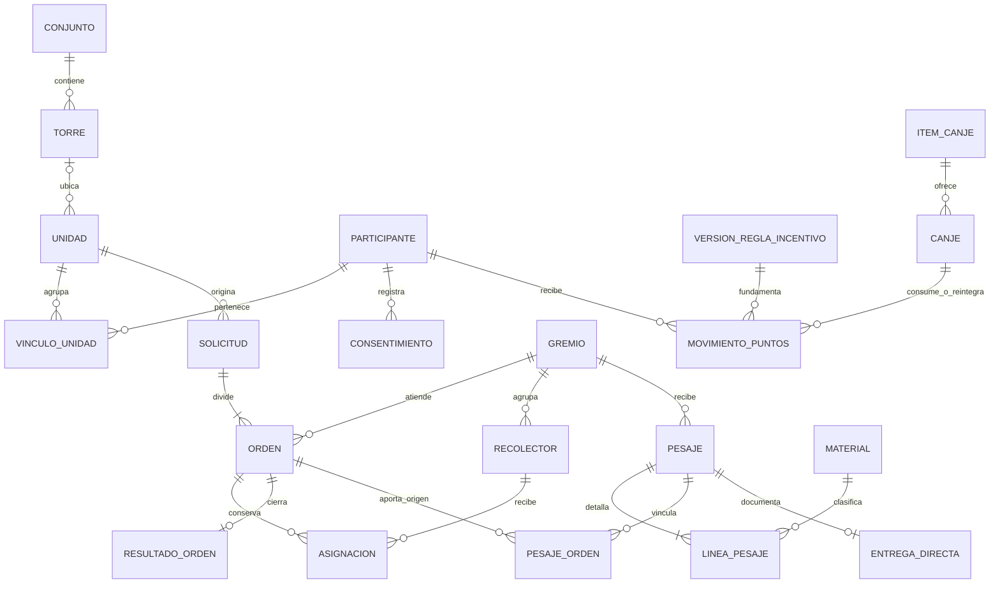

# Diseño de base de datos · Brota

**Estado:** propuesta de diseño lógico, revisable con el contexto de la hackathon.

**Fecha:** 18 de noviembre de 2026.

**Fuente principal:** [Plan Maestro · Brota](../Brota_Plan_Maestro_NeuralSprint.md), especialmente secciones 4, 5, 8, 9, 11, 12 y 13.

**Referencias del repositorio:** [decisiones de infraestructura](decisiones.md) y [contrato modular de API](contrato-api.md).

## 1. Propósito y alcance

Este documento traduce el plan maestro a un modelo relacional que permita explicar qué se recoge, quién lo coordina, qué material se recibe y qué evidencia respalda los informes e incentivos. Conserva el principio «cero pantallas nuevas»: el residente pide por WhatsApp o el canal de respaldo, la coordinación registra por el recolector y el papel sigue siendo una entrada válida.

Es una base para discutir e implementar durante la hackathon; no es un esquema aprobado ni crea tablas, migraciones o dependencias. PostgreSQL ya está elegido en el repositorio. El ORM, la autenticación, los proveedores de IA y los servicios de mensajería siguen pendientes. El modelo no exige el stack propuesto originalmente en el plan.

Se distinguen tres niveles:

| Nivel | Qué significa | Ejemplos |
| --- | --- | --- |
| Base del diseño | Separaciones que responden directamente al problema observado | Solicitud distinta de orden; recolector sin cuenta; pesaje por lote; confirmación humana |
| Regla provisional | Comportamiento del plan que requiere validación operativa | Puntos por entrega, rechazo parcial, participación por hogar, prevención de solicitudes abiertas duplicadas |
| Extensión por prioridad | Capacidad prevista que puede esperar sin bloquear el recorrido inicial | Canjes, rutas recurrentes, certificados persistidos, análisis de fotos de residuos |

Cambiar una regla provisional debe ser posible mediante configuración o una modificación localizada del servicio de dominio. Añadir un concepto nuevo puede requerir una migración: flexibilidad no significa prometer que cualquier cambio será gratuito.

## 2. Hallazgos que justifican el modelo

| Hallazgo del plan | Decisión de datos | Beneficio y límite |
| --- | --- | --- |
| Recicladores y huerta atienden trabajos diferentes | Una solicitud contiene una orden por gremio | Cada equipo avanza por separado; recoger reciclables no cierra orgánicos |
| El recolector puede no tener teléfono ni usar el sistema | Separar persona recolectora, contacto y cuenta operadora | Se registra su trabajo sin inventar un acceso o un celular obligatorio |
| El material de varios hogares llega mezclado al acopio | Separar lote pesado y órdenes de origen | Se conocen kilos reales del lote sin fabricar kilos por apartamento |
| El papel es el registro cotidiano | Conservar referencia del tiquete y separar extracción de confirmación | Una foto ayuda a digitar; la propuesta de IA no se convierte sola en evidencia |
| Hay entregas directas y registro progresivo | Admitir recepción sin orden previa y sin residente identificado | El material puede registrarse; no se asignan puntos personales sin beneficiario verificable |
| La conexión falla | Operaciones idempotentes y control de versión | Un reintento no duplica el registro; dos cambios distintos sí requieren resolver conflictos |
| Los incentivos aún son propuestas | Reglas versionadas y libro de movimientos | Se puede cambiar la fórmula sin reescribir la historia |
| La Fundación necesita evidencia y datos mínimos | Trazabilidad interna y reportes agregados | Cada cifra tiene origen, mientras el ranking público evita datos personales |

## 3. Convenciones del diseño

- Nombres de tablas y columnas en `snake_case`. Los nombres de tablas siguientes son propuestos, no un contrato público de API.
- `id` como clave primaria UUID, generado por el servidor. El cliente usa un identificador de operación separado para reintentos; sus referencias temporales offline se resuelven al sincronizar.
- `created_at` y `updated_at` como instantes con zona, almacenados de forma consistente en UTC. Los periodos del barrio se delimitan en `America/Bogota` y luego se convierten a instantes para consultar.
- Fechas de vigencia mediante intervalos `[desde, hasta)`: inicio incluido y fin excluido. Esto evita solapamientos en cambios de tarifa o regla.
- Kilos, cantidades y equivalencias con `numeric`, nunca coma flotante. Propuesta inicial: `numeric(12,3)` para kg y `numeric(14,4)` para precios unitarios; precisión y redondeo por validar con los tiquetes reales.
- Importes y puntos calculados con precisión decimal y redondeo explícito. La escala de puntos queda pendiente de decidir; no se asume que una futura bonificación deba ser entera.
- `NULL` expresa dato desconocido o no aplicable; cero expresa una medición o valor de cero. No se transforma un peso ilegible en cero.
- PK, FK, unicidad y restricciones numéricas protegen la integridad. Las transiciones, autorizaciones y decisiones entre varias entidades se validan en servicios transaccionales.
- Los catálogos se desactivan para usos futuros conservando referencias históricas. No se introduce un borrado lógico general para todas las tablas.
- JSON se reserva para propuestas de IA, parámetros acotados y metadatos técnicos. Kilos, relaciones y puntos viven en columnas y tablas consultables.

## 4. Vista de relaciones

El diagrama muestra el núcleo y los incentivos. Las relaciones opcionales y las condiciones de integridad se detallan después.



`cuenta_operadora` confirma resultados y pesajes y registra asignaciones. `evento_dominio` conserva los cambios relevantes. Se omiten sus conexiones del diagrama para mantenerlo legible.

## 5. Diccionario del núcleo

Notación: `PK` = clave primaria, `FK` = referencia, `UQ` = unicidad; `?` = opcional. Todas las entidades principales incluyen `id` y fecha de creación, salvo tablas de enlace con clave compuesta. Las columnas enumeradas son la base propuesta, no un DDL exhaustivo.

### 5.1. Territorio, identidad y operación humana

| Tabla | Campos principales | Restricciones y finalidad |
| --- | --- | --- |
| `conjunto` | `id PK`, `nombre`, `etapa?`, `activo` | Brisas de San Pablo es un registro, no una condición escrita en código |
| `torre` | `id PK`, `conjunto_id FK`, `codigo`, `nombre?`, `activo` | `UQ(conjunto_id, codigo)`; no obliga a que todo negocio pertenezca a una torre |
| `unidad` | `id PK`, `tipo`, `torre_id FK?`, `referencia_local`, `direccion_referencia?`, `activo` | Hogar o negocio. Evitar duplicados de apartamento dentro de una torre; no aplicar esa clave a direcciones del corredor |
| `participante` | `id PK`, `nombre`, `celular_normalizado?`, `estado` | Persona de contacto residente o de negocio. Celular único entre contactos vigentes cuando exista; el registro asistido puede empezar sin celular |
| `vinculo_unidad` | `id PK`, `participante_id FK`, `unidad_id FK`, `tipo_vinculo`, `vigente_desde`, `vigente_hasta?` | Permite varios contactos y mudanzas. Validar vínculos duplicados y la política de contacto principal |
| `consentimiento` | `id PK`, `participante_id FK`, `version_politica`, `decision`, `registrado_at`, `canal`, `referencia_evidencia?` | Historial de aceptación o retiro; no un booleano que pierde fecha y versión |
| `gremio` | `id PK`, `codigo UQ`, `nombre`, `activo` | Semillas propuestas: Asorescatar y Ecorazón. Equivale a `equipo` en el contrato de API |
| `recolector` | `id PK`, `gremio_id FK`, `nombre`, `telefono_contacto?`, `activo` | No contiene credenciales ni exige una cuenta; un cambio de gremio debe preservar el historial previo |
| `cuenta_operadora` | `id PK`, `nombre`, `referencia_autenticacion?`, `activo` | Coordinación, administración y acceso institucional. El mecanismo de acceso se decide con el reto |
| `permiso_operador` | `id PK`, `cuenta_id FK`, `rol`, `gremio_id FK?` | Alcance por gremio para coordinación; alcance institucional explícito para reportes. No interpretar un gremio nulo como permiso total por defecto |

Separar `participante` de `cuenta_operadora` evita exigir contraseñas al residente. El número de WhatsApp identifica un contacto del canal, pero no demuestra por sí solo que alguien pueda ver informes o actuar como coordinador. La verificación del canal y la recuperación de acceso son decisiones del adaptador de identidad.

El plan agrupa roles bajo «Usuario» y también dice que el recolector no tiene cuenta. Aquí se conserva su intención separando esas responsabilidades. Si después un recolector usa el sistema, podrá asociarse una cuenta sin modificar sus pesajes anteriores.

La geolocalización es opcional y se añadiría únicamente si el caso de uso la necesita. Tampoco se exige dirección exacta de negocio cuando una referencia operativa sea suficiente.

### 5.2. Solicitud, orden y resultado

| Tabla | Campos principales | Restricciones y finalidad |
| --- | --- | --- |
| `tipo_servicio` | `id PK`, `codigo UQ`, `nombre`, `gremio_id FK`, `activo` | Orgánicos y reciclables son datos iniciales; cada tipo se enruta a un gremio |
| `solicitud` | `id PK`, `codigo_pasaporte UQ`, `unidad_id FK`, `participante_id FK?`, `canal_origen`, `observacion?`, `ubicacion_operativa`, `version` | La ubicación operativa conserva la referencia mínima al solicitar; una mudanza posterior no cambia la entrega histórica |
| `solicitud_servicio` | `solicitud_id FK`, `tipo_servicio_id FK`, `orden_id FK` | PK compuesta por solicitud y servicio; registra lo pedido y la orden resultante, aunque cambie luego el enrutamiento del catálogo |
| `orden` | `id PK`, `solicitud_id FK`, `gremio_id FK`, `estado`, `version` | `UQ(solicitud_id, gremio_id)` en la propuesta actual. Una orden por gremio distinto, creada junto con la solicitud |
| `asignacion` | `id PK`, `orden_id FK`, `recolector_id FK`, `inicio?`, `fin?`, `forma_aviso`, `registrada_por FK`, `vigente_desde`, `vigente_hasta?` | A lo sumo una vigente por orden. Ambos horarios presentes o ambos ausentes; si existen, `fin > inicio` |
| `resultado_orden` | `id PK`, `orden_id FK UQ`, `resultado`, `motivo_rechazo_id FK?`, `observacion?`, `confirmado_por FK`, `ocurrido_at`, `confirmado_at` | Recogida o rechazada en el recorrido inicial; rechazo exige motivo. El actor confirma el reporte verbal del recolector |
| `motivo_rechazo` | `id PK`, `codigo UQ`, `nombre`, `gremio_id FK?`, `activo` | Mojado, mezclado, contaminado y no aprovechable como ejemplos revisables |

El Pasaporte Circular es el identificador legible de la solicitud y la navegación a órdenes, resultados, pesajes y puntos. No exige QR ni una tabla duplicada con los mismos datos. Los pesajes sin solicitud tienen su propio identificador y trazabilidad de recepción.

En una solicitud mixta, los vínculos de servicio deben apuntar a órdenes de esa misma solicitud y del gremio resuelto al crearla. La solicitud, sus servicios y todas sus órdenes se guardan en una sola transacción.

El estado general de la solicitud se calcula a partir de sus órdenes. Si se almacena para acelerar consultas, será una proyección reconstruible. «Una orden recogida y otra pendiente» debe seguir visible como atención parcial.

El contrato modular permite reemplazar la asignación vigente y conserva las anteriores para explicar reasignaciones. El recolector asignado debe estar activo y pertenecer al gremio de la orden en ese momento; una reorganización futura no debe alterar esa evidencia.

### 5.3. Recepción y medición del material

| Tabla | Campos principales | Restricciones y finalidad |
| --- | --- | --- |
| `material` | `id PK`, `codigo UQ`, `nombre`, `gremio_id FK`, `activo` | Ejemplos: cartón, PET, archivo, orgánicos. No se aceptan materiales inventados por IA fuera del catálogo |
| `pesaje` | `id PK`, `gremio_id FK`, `recolector_id FK?`, `proveedor_referencia?`, `fecha_medicion`, `origen_captura`, `estado`, `numero_tiquete?`, `emisor_tiquete?`, `torre_origen_id FK?`, `unidad_medida_id FK?`, `confirmado_por FK?`, `confirmado_at?`, `version`, `sustituye_pesaje_id FK?` | Estado borrador, confirmado o anulado. El proveedor del papel no se equipara automáticamente a un residente. El recolector puede faltar en una entrega directa |
| `linea_pesaje` | `id PK`, `pesaje_id FK`, `material_id FK`, `kg_aceptados`, `kg_rechazados`, `motivo_rechazo_id FK?`, `metodo_medicion`, `cantidad_original?`, `version_equivalencia_id FK?`, `precio_kg_aplicado?`, `version_precio_id FK?` | Pesos no negativos, alguna cantidad mayor que cero y motivo si hay rechazo. `UQ(pesaje_id, material_id)` para el primer recorrido |
| `pesaje_orden` | `pesaje_id FK`, `orden_id FK` | PK compuesta. Asociación de procedencia, sin columna de kilos atribuidos a la orden |
| `entrega_directa` | `id PK`, `pesaje_id FK UQ`, `unidad_id FK?`, `participante_id FK?`, `punto_recepcion`, `recibida_por FK` | Recepción en huerta o acopio sin solicitud ni asignación artificiales. Para incentivo personal exige identificar y validar al beneficiario |

`unidad_medida_id` significa **unidad del barrio a la que se midió el material individualmente**, no unidad física de medida. Si existe, el pesaje completo corresponde a esa unidad y su torre debe ser coherente. No se llena para un lote mezclado.

El núcleo distingue dos preguntas: «¿se recogió y se separó bien?» y «¿cuántos kilos llegaron?». Un resultado humano puede habilitar puntos por entrega válida antes del pesaje. Los puntos por kg requieren una medición individual confirmada y la modalidad correspondiente activada.

**Reglas de atribución que evitan cifras ficticias:**

1. Vincular seis órdenes a un lote de 12 kg no permite afirmar que cada hogar entregó 2 kg.
2. `torre_origen_id` solo se completa si el lote está identificado como procedente de esa torre. Si mezcla torres sin separación medible, queda sin atribución territorial.
3. Para medir varias torres, se registran pesajes separados de material realmente separado; no se copia el peso total en cada torre.
4. Un pesaje individual puede vincularse a la orden correspondiente o a una entrega directa. La unidad y el beneficiario deben coincidir con la procedencia confirmada.
5. El peso se agrega desde `linea_pesaje` una sola vez. Unir directamente sus filas con varias órdenes y sumar multiplicaría los kilos.
6. No se prohíben varios pesajes por orden hasta saber si existen entregas parciales. Cada registro debe representar material distinto; la idempotencia y la revisión de tiquetes ayudan a evitar repeticiones, sin confundir una división legítima con un duplicado.

El plan pide kilos por torre, pero eso solo es posible si el proceso conserva esa procedencia. Cuando no la conserve, el informe mostrará kilos sin torre identificada; no intentará suplir con software un dato que no se midió.

Para baldes se conserva la cantidad original —incluidos medios baldes—, la equivalencia aplicada y los kg resultantes. Se marcará como estimación por conversión, distinguible del peso de báscula. Cambiar «kg por balde» no recalcula recepciones pasadas.

El número impreso del tiquete puede repetirse entre emisores o periodos. No será globalmente único sin validar la numeración real. Se usa como señal de posible duplicado junto con emisor, fecha, proveedor y evidencia.

## 6. Reglas variables, incentivos y extensiones del plan

### 6.1. Configuración con historia

| Tabla propuesta | Información | Decisión técnica |
| --- | --- | --- |
| `version_precio_material` | Material, precio/kg, moneda, intervalo de vigencia | Conservar lista de Asorescatar por versión; precio cero y precio desconocido son distintos |
| `version_equivalencia` | Gremio o punto de recepción, recipiente, kg/unidad, vigencia | La equivalencia pertenece al contexto donde se usa, no a una constante global |
| `version_regla_incentivo` | Código, modalidad, ámbito, parámetros, vigencia, aprobada por | Soporta entrega válida, entrega directa, kg individual y rachas si se aprueban |
| `modalidad_conjunto` | Conjunto, modalidad de incentivo y vigencia | Activa puntos por peso solo donde realmente exista medición individual |
| `version_regla_liga` | Periodo, conjunto, fórmula identificada y parámetros | Permite distinguir ranking por participación de otras propuestas |
| `capacidad_torre` | Torre, número de viviendas, vigencia | Denominador positivo e histórico para comparar torres sin usar el número de usuarios registrados |

No se editan versiones ya aplicadas: se cierra su vigencia y se crea otra. Se impiden intervalos solapados para el mismo ámbito y concepto. La prioridad entre una regla global y una específica debe resolverse explícitamente; no se permite una selección ambigua.

Los parámetros pueden ser JSON validado para cada familia de regla; el evaluador sigue siendo código pequeño y conocido. No se propone almacenar expresiones arbitrarias o construir un motor universal durante la hackathon. Cambiar el valor de un premio es configuración; cambiar qué significa «entrega válida» puede exigir modificar lógica y pruebas.

### 6.2. Libro de puntos y canjes

| Tabla | Campos relevantes | Integridad |
| --- | --- | --- |
| `movimiento_puntos` | `id PK`, `participante_id FK`, `unidad_id FK`, `torre_id FK?`, `delta`, `tipo`, `version_regla_id FK?`, `resultado_orden_id FK?`, `entrega_directa_id FK?`, `pesaje_id FK?`, `canje_id FK?`, `revierte_movimiento_id FK?`, `clave_aplicacion UQ`, `ocurrido_at` | Movimiento inmutable, con origen válido y beneficiario identificado; la unidad y torre son las del hecho histórico |
| `aliado` | `id PK`, `nombre`, `unidad_negocio_id FK?`, `activo` | Huerta o negocio oferente; no todo aliado necesita una unidad residencial |
| `item_canje` | `id PK`, `aliado_id FK`, `nombre`, `costo_puntos`, `existencias?`, `activo` | Abono, plántulas o descuentos. `NULL` en existencias significa inventario no controlado, no cero |
| `canje` | `id PK`, `participante_id FK`, `item_id FK`, `cantidad`, `costo_unitario_aplicado`, `total_puntos`, `estado`, `registrado_por FK` | Conserva el costo aceptado aunque cambie el catálogo. Cantidad positiva; inventario y saldo se validan bajo concurrencia |

El saldo es la suma de movimientos; una columna de saldo sería únicamente una proyección conciliable. Un rechazo aporta cero: no crea una penalización. Los movimientos negativos representan consumo por canje o reversión de un abono incorrecto, diferenciados por tipo y motivo.

`clave_aplicacion` identifica el hecho premiable y la familia del beneficio. No depende solo de la versión de regla: cambiar una regla no permite premiar otra vez la misma entrega. Si se aprueba un recálculo, se hace una reversión y un nuevo movimiento explícitos.

Las referencias de origen se validan por tipo de movimiento, evitando filas con referencias incompatibles. La regla debe declarar si los puntos por kg sustituyen o complementan los puntos por entrega; no se acumulan ambos por suposición.

La propuesta conserva participante y unidad porque el plan menciona ambos. Debe confirmarse si el saldo pertenece a la persona o al hogar. La base provisional es saldo personal y contribución territorial histórica; si se aprueba saldo compartido por hogar, se añadirá una cuenta de puntos por unidad antes de implementar canjes.

Canjear exige una transacción que reserve existencias, compruebe saldo y registre canje y débito de forma indivisible. Dos solicitudes concurrentes no pueden gastar el mismo saldo o la última unidad disponible. Cancelar un canje ya debitado requiere un reintegro trazable y una política de devolución de inventario.

### 6.3. Educación, archivos e IA

| Tabla propuesta | Datos que conserva | Uso |
| --- | --- | --- |
| `contenido_educativo` | Título, tipo, recurso, estado activo | Video corto o imagen |
| `contenido_motivo` / `contenido_material` | Enlaces con motivos y materiales | Un mismo contenido puede servir a varias causas de rechazo |
| `archivo` | Clave de almacenamiento, MIME, tamaño, huella, propósito, fecha de expiración y eliminación | Foto o audio fuera de la base; la base guarda metadatos y controla su ciclo |
| `solicitud_archivo` / `pesaje_archivo` | FK al registro y al archivo | Evidencia con relaciones comprobables, evitando referencias genéricas sin FK |
| `procesamiento_ia` | Archivo, tarea, proveedor/modelo, versión del esquema, propuesta JSON, confianza, estado y revisión humana | Borrador de extracción o interpretación; no es un resultado confirmado |

La IA no asigna puntos, no crea pesos oficiales ni identifica con certeza a un proveedor por leer un nombre. El operador resuelve materiales y personas contra sus catálogos y confirma los valores finales. Para una solicitud interpretada desde audio, el residente confirma antes de crear el trabajo operativo.

Las propuestas de IA pueden contener datos personales; están sujetas a retención junto con sus archivos. Eliminar la foto no basta si el mismo contenido queda indefinidamente en JSON, registros técnicos o respuestas de proveedores.

### 6.4. Operación comercial y capacidades posteriores

El negocio es una `unidad` con tipo negocio; eso permite reutilizar solicitud, órdenes y medición. La ruta fija y «Hoy hay más» necesitan, si se priorizan, `programacion_recoleccion` con negocio, gremio, frecuencia, horario y vigencia. Cada ocurrencia genera una orden con una clave única de programación y fecha; la programación no sustituye el historial de atención. El botón de mayor volumen registra una petición u observación, sin inventar kilos.

La hoja de ruta se genera a partir de asignaciones. El Sello Negocio Verde, reportes de cosecha, mapas y predicción quedan como extensiones con contrato propio: no se mezclan cosecha producida y residuos recibidos en la misma tabla de pesajes.

## 7. Ciclo de vida e integridad transaccional

### 7.1. Estados propuestos

El recorrido mínimo comparte estos estados con el contrato modular:

```text
orden: nueva → asignada → recogida
                       ↘ rechazada

pesaje: borrador → confirmado → anulado, si procede una corrección
```

`enrutada` puede representarse mediante la existencia de las órdenes; `pesada` mediante pesajes confirmados; `puntuada` mediante movimientos. No se obliga a que todas sean etapas de una sola máquina de estados: una entrega válida puede generar puntos aunque el lote todavía no se haya pesado.

Cancelación, rechazo parcial, recogida parcial y reapertura figuran como necesidades por validar. La estructura distingue el resultado de la orden del rechazo de kilos en el acopio. Rechazar parte del peso no permite inferir qué hogar contaminó un lote mezclado ni quitarle automáticamente puntos a sus integrantes.

Si se aprueba resultado parcial por orden, se ampliarán sus estados y detalle de resultado, conservando quién confirmó qué material. No se añadirá simplemente un estado nuevo sin definir su efecto en puntos, cierre e informes.

### 7.2. Operaciones que deben ser atómicas

| Operación | Qué se guarda o valida conjuntamente |
| --- | --- |
| Crear solicitud mixta | Solicitud, selección de servicios, órdenes, historial y registro de idempotencia |
| Asignar o reasignar | Alcance del operador, estado y versión esperados, gremio del recolector, cierre de asignación previa y nueva asignación |
| Confirmar resultado | Resultado humano, estado de orden, evento y crédito único si corresponde; si el crédito es asíncrono, se publica un evento durable en la misma transacción |
| Confirmar pesaje | Cabecera, líneas, procedencia, referencias a reglas y precios aplicados, autor y fecha de confirmación |
| Corregir pesaje confirmado | Motivo, autor, anulación del registro anterior y nuevo pesaje con `sustituye_pesaje_id`; reversión explícita de efectos derivados que corresponda |
| Canjear | Comprobación de saldo, control concurrente de inventario, canje y débito |

El tipo y gremio de material, orden, pesaje y recolector deben ser coherentes. Donde sea viable se usarán claves compuestas; las comprobaciones restantes se ejecutarán dentro de la transacción. Las FK aisladas no comprueban por sí solas que dos registros pertenezcan al mismo gremio.

## 8. Offline, reintentos y auditoría

La tablet conserva operaciones pendientes en su almacenamiento local. Un registro local todavía no forma parte de los indicadores oficiales del servidor.

| Registro técnico | Datos propuestos | Propósito |
| --- | --- | --- |
| `operacion_idempotente` | Actor, ruta/caso de uso, clave, huella de entrada, estado, resultado, fechas | Unicidad por actor, ruta y clave; misma entrada devuelve el mismo resultado; contenido distinto produce conflicto |
| `evento_dominio` | Tipo, solicitud/orden/pesaje/canje afectado, actor, instante ocurrido y registrado, versión y cambio mínimo | Historia de acciones relevantes; no almacena indiscriminadamente mensajes o teléfonos |
| `evento_salida` | Evento de origen, tipo de envío, destino referenciado, estado, intentos y próxima ejecución | Avisos de asignación, puntos o educación reintentables después de confirmar la escritura |

`evento_dominio` debe usar FK concretas o tablas de enlace para sus entidades soportadas. No se propone reconstruir todo el sistema desde eventos: las tablas del dominio siguen siendo la fuente operativa.

La escritura y su registro de idempotencia se confirman juntas. Dos peticiones simultáneas con la misma clave se serializan mediante unicidad y coordinación transaccional; no basta con consultar primero si existe. Envíos externos se procesan después del commit mediante `evento_salida`; un fallo de mensajería no revierte una recolección ya registrada.

El contrato modular conserva claves HTTP al menos 24 horas y exige que la retención offline cubra la ventana anunciada por el servidor. Antes de habilitar offline se acordará cuánto tiempo puede pasar una tablet desconectada y se retendrán identificadores de operación durante esa ventana, o se rechazará una sincronización demasiado antigua para revisión. No se promete deduplicación indefinida con claves ya eliminadas.

La versión esperada evita que una tablet sobrescriba una reasignación más reciente. Ante conflicto se conserva el trabajo pendiente y se solicita revisión; no se aplica «último en escribir gana» a resultados o pesajes. Los lotes de sincronización tendrán dependencias y confirmación por operación para poder reintentar solo lo pendiente.

El cliente puede generar referencias temporales locales; el servidor devuelve su correspondencia con IDs definitivos, respetando el contrato actual. Un webhook repetido se deduplica además por proveedor e identificador externo del mensaje. Esto no equivale a detectar dos solicitudes genuinamente distintas del mismo hogar: esa regla de negocio se valida por separado.

## 9. Indicadores y evidencia

Los paneles se construyen como consultas o vistas sobre registros confirmados, sin mantener una segunda base de totales manuales.

| Indicador | Fuente y criterio propuesto | Límite que debe mostrarse |
| --- | --- | --- |
| Kg aceptados y rechazados | Líneas de pesajes confirmados no anulados, por fecha de medición | Distinguir báscula y estimación; excluir borradores y no duplicar por enlaces a órdenes |
| Participación de una torre | Hogares distintos con entrega válida en el periodo / viviendas vigentes de la torre | No contar mensajes, órdenes repetidas ni contactos como hogares; excluir negocios del denominador residencial |
| Kg por torre | Pesajes con procedencia territorial comprobada | Informar también kilos sin atribución; no repartir lotes mezclados |
| Tasa de rechazo por peso | Kg rechazados / (kg aceptados + kg rechazados) | Sin peso total: «sin datos», no un éxito del 0 % |
| Tasa de órdenes rechazadas | Órdenes rechazadas / órdenes con resultado final | Es una métrica distinta de la tasa por peso |
| Valor estimado por reciclador | Kg aceptados × precio aplicado, cuando se conozca | No acredita un pago ni ingreso efectivamente recibido; el pago requeriría su propio registro |
| Estado de solicitudes | Agregación de órdenes independientes | Mantener visible la atención pendiente de una solicitud mixta |

Para torres cuyo número de viviendas cambie dentro del periodo se acordará una fecha de corte o un denominador ponderado antes de publicar el ranking. `capacidad_torre` permite ambas opciones sin reemplazar datos históricos.

El Certificado Verde es una salida agregada del mismo modelo. Si se requiere conservar cada emisión, `certificado_emitido` guardará conjunto, periodo, corte de datos, versión de fórmula, fecha, archivo y referencia a una nueva emisión correctiva. La evidencia detallada quedará accesible internamente para reproducir sus cifras. Tal como indica el plan, es apoyo documental y no determina por sí solo una reducción de tarifa.

## 10. Acceso, privacidad y conservación

El diseño recoge los requisitos de datos mínimos y consentimiento del plan; no constituye una validación jurídica de cumplimiento.

- Coordinación accede a órdenes y registros de su gremio. La Fundación consulta agregados; permisos adicionales se conceden expresamente.
- La Liga pública no expone nombres, celulares ni apartamentos. Los códigos de Pasaporte no funcionan como credenciales de acceso a información personal.
- La cuenta de ejecución de la API tendrá permisos restringidos, separados de la cuenta que aplica migraciones, según las decisiones de infraestructura existentes.
- Los borrados se evalúan por finalidad: datos de contacto, evidencia multimedia y hechos operativos no necesitan la misma retención. Los plazos concretos quedan pendientes del responsable del proyecto.
- Ante una solicitud de eliminación se retiran contactos, referencias operativas personales, copias de IA y vínculos que ya no deban conservarse, sin dejar información equivalente en logs. La conservación de hechos agregados y evidencia necesaria debe acordarse; quitar el nombre no garantiza anonimato si torre y apartamento siguen identificando al hogar.
- Respaldos, exportaciones y archivos también forman parte del ciclo de conservación. El procedimiento de restauración debe contemplar solicitudes de eliminación ya atendidas.

Se indexarán claves de consulta sin copiar teléfonos y nombres a tablas de eventos o reportes. El detalle de credenciales, sesiones y dispositivos se diseñará con el mecanismo de autenticación elegido; no se guardan PIN o contraseñas en texto plano.

## 11. Índices y consistencia propuestos

Comenzar con los índices necesarios para el recorrido observado y revisar su uso con consultas reales. No se requieren particiones, PostGIS o réplicas para explicar ni construir el piloto.

| Índice o restricción | Necesidad |
| --- | --- |
| Únicos en códigos de catálogo y Pasaporte | Identificación estable sin duplicados |
| Único parcial de celular vigente no nulo | Identificación del contacto del canal, sujeto a normalización y política de reasignación de números |
| `orden(gremio_id, estado, created_at, id)` | Bandeja paginada por gremio y estado |
| `solicitud(unidad_id, created_at, id)` | Historial de hogar o negocio |
| Único parcial de asignación vigente por orden | Evitar dos recolectores activos para el mismo trabajo |
| `pesaje(gremio_id, fecha_medicion)` y `pesaje(recolector_id, fecha_medicion)` | Reportes por periodo y proveedor operativo |
| Índices de FK en líneas y enlaces, incluido `pesaje_orden(orden_id)` | Consultar detalle y rastrear órdenes hasta lotes |
| `movimiento_puntos(participante_id, ocurrido_at)` y clave de aplicación única | Saldo, historial y prevención de doble acreditación |
| Clave única de idempotencia y de mensaje externo | Reintentos concurrentes y webhooks repetidos |
| `evento_salida(estado, proximo_intento_at)` | Recuperar avisos pendientes sin recorrer todo el historial |

Se validarán cantidades, ventanas horarias y coherencia de FK al escribir. Las transacciones con saldo, inventario y asignación usarán bloqueo o actualización condicional de versión según el caso. Las restricciones por sí solas no sustituyen el control de concurrencia del servicio.

## 12. Diferencias del plan que requieren una decisión explícita

| Punto | Lectura encontrada | Tratamiento de esta propuesta |
| --- | --- | --- |
| Ranking | Secciones 3 y 11 priorizan porcentaje de hogares; un endpoint de sección 9 dice kg/vivienda | Participación como base provisional; kg como indicador separado hasta aprobar fórmula |
| Momento de puntos | El diagrama lineal sitúa puntos después del pesaje; F9 y sección 11 los vinculan a entrega válida | Crédito por validación humana; kg solo para modalidad individual aprobada |
| QR | Aparece en una línea del ciclo, aunque el plan rechaza QR e imanes reiteradamente | No se requiere QR; Pasaporte legible y canales existentes |
| Usuario y recolector | Tabla resumida incluye rol recolector; otros apartados dicen que no tiene cuenta | Entidad de recolector separada de identidad y cuenta de acceso |
| Racha | La transcripción muestra «-1,5 durante la semana 5» junto al principio de no penalización | No fijar multiplicador o descuento: confirmar el original antes de configurar |
| Rechazo parcial | Se menciona como ajuste del plan, mientras el resultado inicial de orden distingue recogida y rechazo total | Admitir kg aceptados/rechazados en pesaje; resultado parcial por orden pendiente de contrato |
| Atribución de kilos | Se piden kilos por torre, aunque hay lotes de múltiples hogares | Solo atribuir torre u hogar cuando exista evidencia de procedencia medible |
| Tecnologías | El plan sugiere PostgreSQL 16 y frameworks; el repositorio ya documenta PostgreSQL 18 | Usar la infraestructura acordada; no fijar ORM ni framework por este diseño |

El contrato modular 0.2 desarrolla las interfaces de identidad, entregas directas, borradores, incentivos y offline, además del recorrido manual. Sus rutas son propuestas, no funcionalidades implementadas. El núcleo puede construirse antes de habilitar las extensiones, manteniendo explícitas las reglas pendientes de validar con el reto.

## 13. Decisiones para cerrar con el contexto de la hackathon

| Pregunta concreta | Propuesta de partida | Parte afectada si cambia |
| --- | --- | --- |
| ¿Quién es dueño del saldo: persona, hogar o negocio? | Personal con atribución histórica a unidad | Libro de puntos y canjes |
| ¿Qué constituye entrega válida? ¿Qué ocurre con rechazo parcial? | Confirmación humana sin rechazo total; efecto parcial pendiente | Resultado, elegibilidad y correcciones |
| ¿Se combinan puntos por entrega y por kg? | No asumir acumulación | Evaluador y versiones de reglas |
| ¿Cuántas solicitudes abiertas se permiten por servicio? | Avisar de una existente, como plantea CU-02; definir excepciones antes de imponer una restricción | Creación, concurrencia y recurrencia comercial |
| ¿Se pueden separar físicamente los lotes por torre? | Registrar solo procedencia comprobada | Captura y cobertura del ranking por kg |
| ¿Cuánto pesa un balde y dónde varía? | Equivalencia versionada por punto/gremio | Conversión y calidad de la medición |
| ¿Cómo son los tiquetes y quién figura como proveedor? | Número no globalmente único, proveedor revisado por operador | Duplicados, extracción IA y reportes de valor |
| ¿Cuál es el denominador real de viviendas y la fórmula de Liga? | Hogares participantes / viviendas vigentes | Configuración y consultas del ranking |
| ¿Cuánto tiempo puede operar una tablet sin sincronizar? | Pendiente de prueba en campo | Retención de claves, dependencias y conflictos |
| ¿Qué correcciones, cancelaciones y reaperturas se permiten? | Registro confirmado preservado y corrección trazable | Estados, permisos y efectos sobre puntos |
| ¿Qué datos y evidencias deben conservarse, por cuánto tiempo y quién autoriza su uso? | Mínimos datos y retención diferenciada por finalidad | Identidad, archivos, eventos, exportaciones y respaldos |
| ¿Qué exige el reglamento en stack, APIs y alcance? | Núcleo relacional y adaptadores separados | Migraciones y componentes implementados, sin cambiar los hechos del dominio |

## 14. Orden sugerido de implementación y revisión

1. Validar las preguntas que cambien el núcleo: territorio, actores, gremios, solicitud mixta, resultado y procedencia real del peso.
2. Ajustar el contrato de API y crear migraciones para territorio mínimo, coordinación, catálogos, solicitudes, órdenes, asignaciones, resultados y pesajes manuales. Incluir autorización, idempotencia e historia de acciones desde el primer recorrido.
3. Recorrer con datos ficticios una solicitud mixta con resultados distintos, una entrega rechazada y un lote de varias órdenes sin reparto de kilos. Comprobar consultas de peso y ámbito de acceso.
4. Añadir incentivos si forman parte del alcance evaluado, con regla identificada, acreditación única y reversión. Verificar que repetir un resultado o cambiar una versión de regla no duplique puntos.
5. Incorporar baldes, entregas directas, lectura de tiquete y offline según prioridad. Probar reconexión con reintento y con un conflicto real entre dos operadores.
6. Implementar Liga, certificados y canjes solo después de acordar fórmulas, beneficiarios y evidencia disponible. Verificar que una corrección no duplique kilos ni deje un saldo injustificado.

El criterio de aceptación del diseño es poder seguir un dato desde su captura y confirmación hasta su informe o incentivo, explicar qué se sabe realmente y modificar las reglas pendientes sin borrar esa historia.
