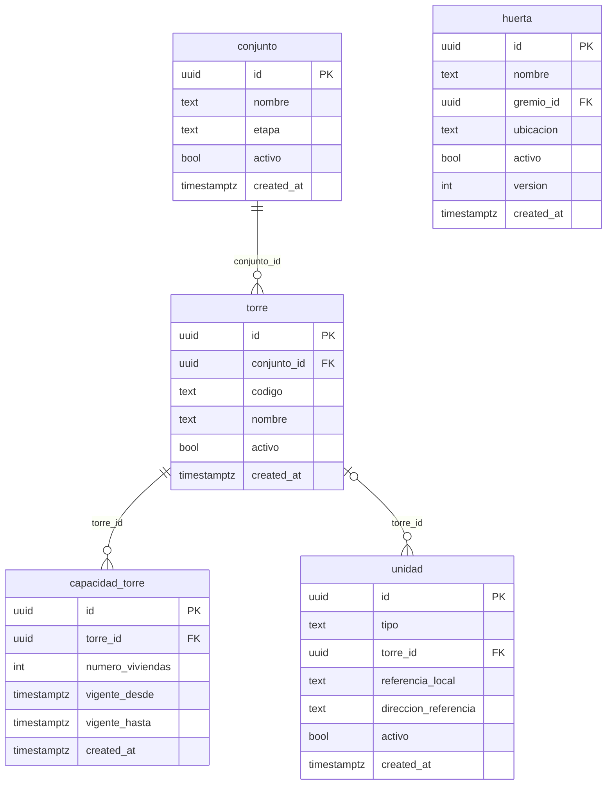
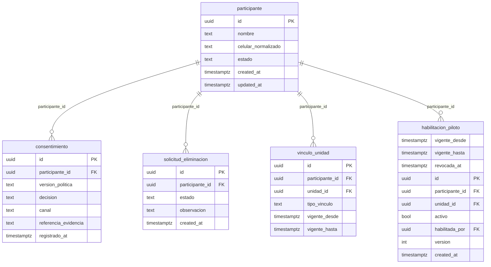
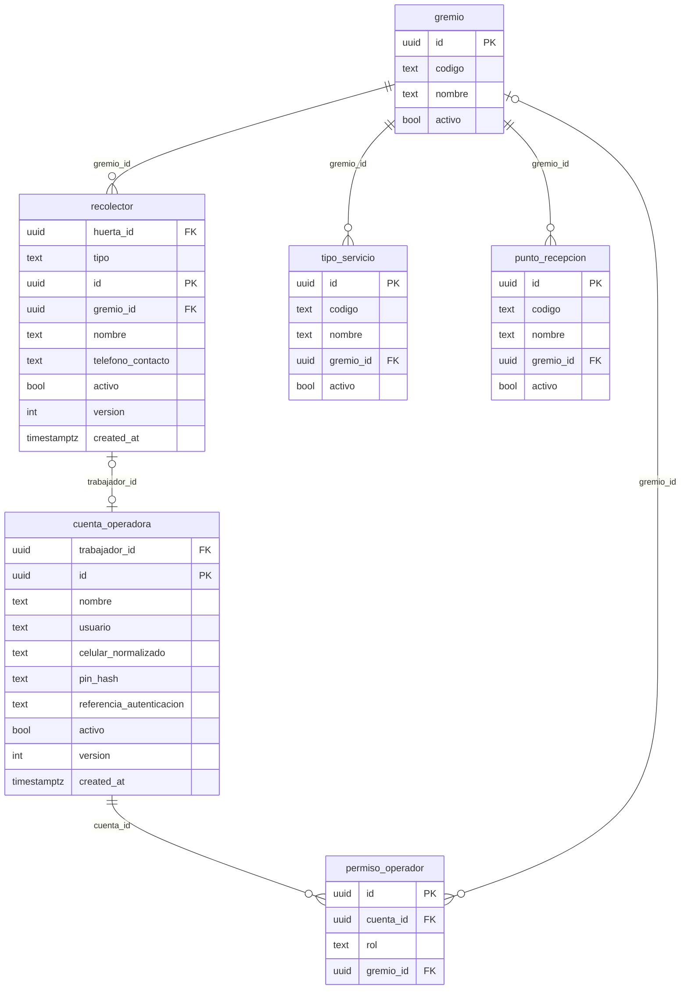
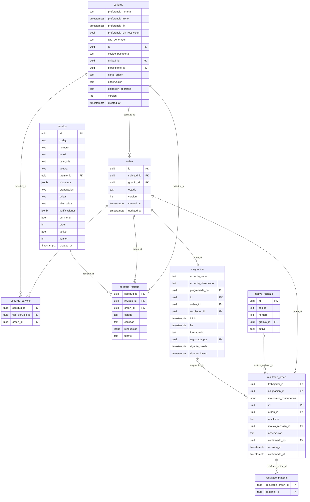
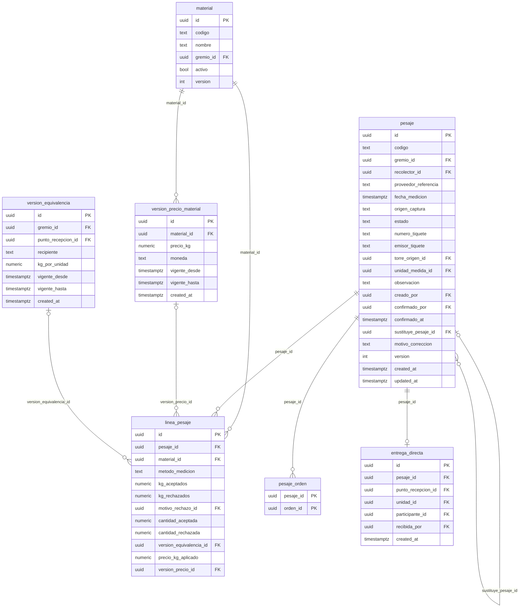
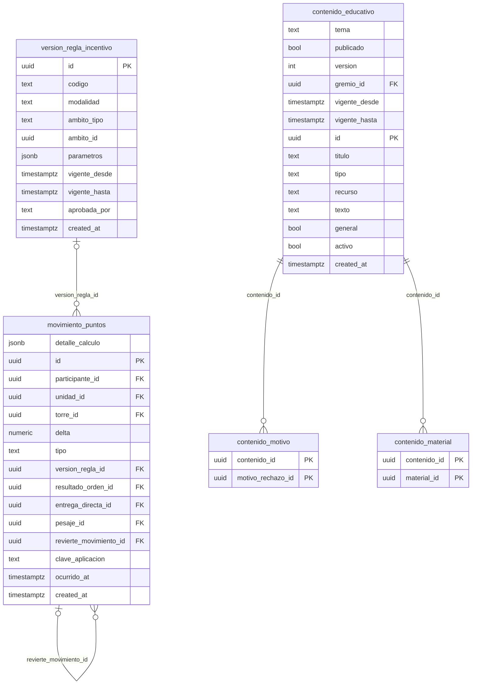
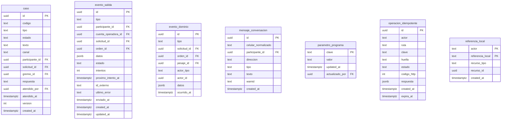

# Modelo de datos · Brota (PostgreSQL)

Generado desde `api/app/models.py` (SQLAlchemy) con las migraciones hasta la **0014**. Para el detalle de
reglas, estados y decisiones, ver [diseno-base-de-datos.md](diseno-base-de-datos.md).

**44 tablas** agrupadas por dominio. `PK` llave primaria, `FK` llave foránea.

## Territorio y unidades

## Personas, consentimiento y piloto

## Operación y permisos

## Solicitud, orden y cierre

## Material, pesaje y valor

## Puntos y educación

## Comunicación, auditoría y operación

## Relaciones entre dominios

| Desde | Campo | Hacia |
|---|---|---|
| `contenido_educativo` | `gremio_id` | `gremio` |
| `huerta` | `gremio_id` | `gremio` |
| `material` | `gremio_id` | `gremio` |
| `mensaje_conversacion` | `participante_id` | `participante` |
| `motivo_rechazo` | `gremio_id` | `gremio` |
| `residuo` | `gremio_id` | `gremio` |
| `contenido_material` | `material_id` | `material` |
| `contenido_motivo` | `motivo_rechazo_id` | `motivo_rechazo` |
| `recolector` | `huerta_id` | `huerta` |
| `version_equivalencia` | `punto_recepcion_id` | `punto_recepcion` |
| `version_equivalencia` | `gremio_id` | `gremio` |
| `solicitud` | `unidad_id` | `unidad` |
| `solicitud` | `participante_id` | `participante` |
| `vinculo_unidad` | `unidad_id` | `unidad` |
| `caso` | `solicitud_id` | `solicitud` |
| `caso` | `participante_id` | `participante` |
| `caso` | `gremio_id` | `gremio` |
| `caso` | `atendido_por` | `cuenta_operadora` |
| `habilitacion_piloto` | `habilitada_por` | `cuenta_operadora` |
| `habilitacion_piloto` | `unidad_id` | `unidad` |
| `orden` | `gremio_id` | `gremio` |
| `parametro_programa` | `actualizado_por` | `cuenta_operadora` |
| `pesaje` | `recolector_id` | `recolector` |
| `pesaje` | `gremio_id` | `gremio` |
| `pesaje` | `confirmado_por` | `cuenta_operadora` |
| `pesaje` | `creado_por` | `cuenta_operadora` |
| `pesaje` | `unidad_medida_id` | `unidad` |
| `pesaje` | `torre_origen_id` | `torre` |
| `asignacion` | `recolector_id` | `recolector` |
| `asignacion` | `programada_por` | `cuenta_operadora` |
| `asignacion` | `registrada_por` | `cuenta_operadora` |
| `entrega_directa` | `punto_recepcion_id` | `punto_recepcion` |
| `entrega_directa` | `recibida_por` | `cuenta_operadora` |
| `entrega_directa` | `participante_id` | `participante` |
| `entrega_directa` | `unidad_id` | `unidad` |
| `evento_dominio` | `orden_id` | `orden` |
| `evento_dominio` | `solicitud_id` | `solicitud` |
| `evento_dominio` | `pesaje_id` | `pesaje` |
| `evento_salida` | `orden_id` | `orden` |
| `evento_salida` | `solicitud_id` | `solicitud` |
| `evento_salida` | `cuenta_operadora_id` | `cuenta_operadora` |
| `evento_salida` | `participante_id` | `participante` |
| `linea_pesaje` | `motivo_rechazo_id` | `motivo_rechazo` |
| `pesaje_orden` | `orden_id` | `orden` |
| `solicitud_servicio` | `tipo_servicio_id` | `tipo_servicio` |
| `resultado_orden` | `trabajador_id` | `recolector` |
| `resultado_orden` | `confirmado_por` | `cuenta_operadora` |
| `movimiento_puntos` | `pesaje_id` | `pesaje` |
| `movimiento_puntos` | `entrega_directa_id` | `entrega_directa` |
| `movimiento_puntos` | `resultado_orden_id` | `resultado_orden` |
| `movimiento_puntos` | `unidad_id` | `unidad` |
| `movimiento_puntos` | `participante_id` | `participante` |
| `movimiento_puntos` | `torre_id` | `torre` |
| `resultado_material` | `material_id` | `material` |

## Reglas que protege la base

- **RN-01 separación de flujos:** cada `solicitud_servicio` apunta a un `tipo_servicio` de un `gremio`; cada `orden` pertenece a un solo gremio.
- **RN-02 programación:** la API solo pasa una `orden` a `programada` con `POST /v1/ordenes/{id}/programacion`, que exige día, hora y persona; `asignacion` guarda `inicio`/`fin` con CHECK de horario completo y ordenado.
- **RN-03 asignación:** `asignacion` une la orden con el `recolector` y la cuenta que asignó.
- **RN-04 trazabilidad:** identificador (`codigo_pasaporte`), estado y `evento_dominio` por cada cambio.
- **RN-05 cierre / RN-06 puntos:** cada `movimiento_puntos` apunta al `resultado_orden` o `pesaje` que lo originó, a la `version_regla_incentivo` usada y guarda `detalle_calculo`; la API solo abona al registrar la recolección.
- **RN-07 privacidad:** el celular vive en `participante` y solo se expone a quien atiende; `mensaje_conversacion` se borra a los 30 días.
- **RN-08 piloto:** `habilitacion_piloto` por persona y unidad, con vigencia; nadie queda habilitado por defecto.
