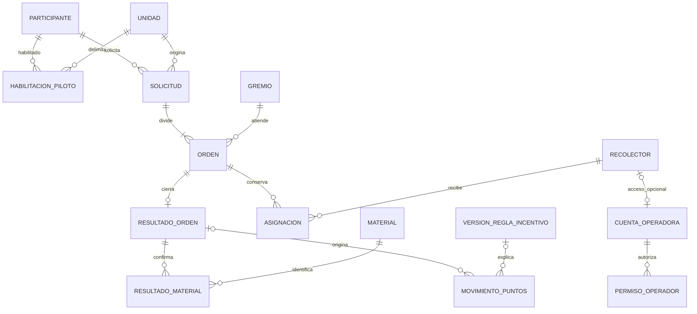
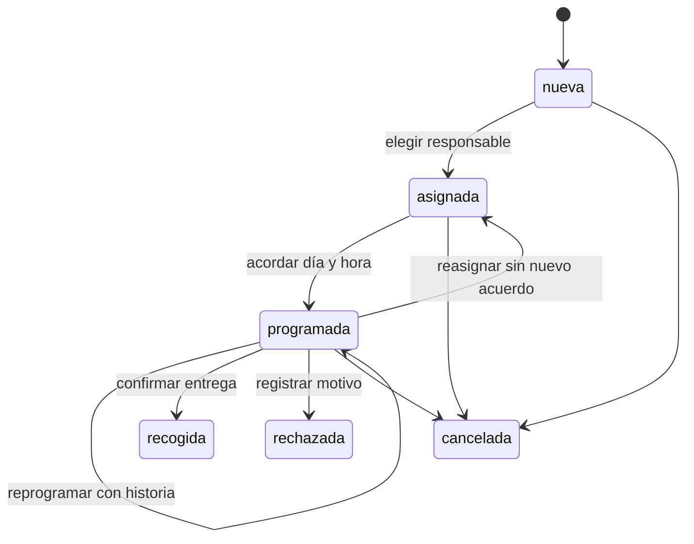

# Plan de implementación de API y base de datos para EcoConecta

Fecha: 20 de noviembre de 2026. Base revisada: `develop`, commit `3aa95d7`.

Objetivo: demostrar todos los requisitos funcionales del reto oficial con el código existente, mediante cambios incrementales en FastAPI y PostgreSQL. Primero se cierra el recorrido obligatorio: información → solicitud → colectivo correcto → asignación → programación comunicada → recolección → puntos explicables.

Este es un plan de trabajo; las tablas, rutas y migraciones marcadas como propuestas todavía no están implementadas. El estado observado corresponde a revisión de código, no a una nueva ejecución de pruebas o verificación del despliegue.

## 1. Fuentes y prioridad

1. **Reto Oficial Hackathon EcoConecta**, PDF entregado por el equipo: secciones 4 a 7, páginas 3 a 5, para actores y requisitos; secciones 8 a 11, páginas 5 y 6, para tecnologías, nube, entregables y demo; página 7 para cronograma.
2. [Plan Maestro](../Brota_Plan_Maestro_NeuralSprint.md): aporta WhatsApp como canal principal, solicitud mixta, Pasaporte Circular, papel, pesajes manuales y baldes, accesibilidad y confirmación humana. Sus funcionalidades adicionales no desplazan requisitos oficiales.
3. Implementación: [modelos](../api/app/models.py), [módulos](../api/app/modulos/), [seguridad](../api/app/core/seguridad.py), [migraciones](../api/migrations/versions/), [panel](../web/coordinacion/README.md) y [contrato](contrato-api.md).

Los códigos RF usados abajo son identificadores de trabajo de este plan; RN-01 a RN-08 son los del documento oficial. Las decisiones de diseño se proponen para cumplir el reto, sin atribuirlas a FSD como soluciones obligatorias.

## 2. Decisiones que cambian la prioridad

| Hallazgo oficial | Diferencia actual | Acción prioritaria |
| --- | --- | --- |
| Proveedores de IA autorizados: OpenAI, Azure OpenAI, Azure AI Foundry y Claude | `ia.py` y su configuración usan Gemini | P0: desactivar llamadas a Gemini en la configuración de entrega y en el bot. Mantener catálogo, botones y formularios. P1: sustituir el adaptador por un proveedor autorizado si hay credenciales y tiempo. IA es opcional. |
| Recolector como perfil con consulta y registro de recolección | Solo existen roles `coordinacion`, `fundacion` y `admin`; el recolector es un registro sin acceso | P0: agregar rol de recolector y vincularlo con una cuenta opcional. Darle vista de sus asignaciones y cierre. Conservar registro asistido por coordinación. |
| Solicitud con disponibilidad/preferencia horaria | `SolicitudIn` solo recibe unidad, servicios, residuos y observación | P0: capturar preferencia explícita y devolverla a coordinación. |
| No está programada sin día, hora y persona | La asignación acepta horarios nulos y deja estado `asignada` | P0: distinguir asignación de programación. Sin horario puede estar asignada, nunca programada. |
| Usuarios piloto configurables, no toda la comunidad habilitada | No existe habilitación de piloto | P0: autorizar a cada participante por unidad y vigencia; denegar nuevas solicitudes sin habilitación. |
| MVP accesible desde nube durante evaluación | La bitácora describe ejecución en PC y túnel | P0: desplegar los contenedores en un servicio de nube; el túnel al PC no basta como evidencia de alojamiento en nube. |
| Estilos permitidos: Tailwind CSS y Bootstrap | El panel usa CSS propio | P0 de interfaz: incorporar Bootstrap o Tailwind para el flujo evaluado. Mantener el CSS propio como ajustes y documentar el stack. |

P0 significa necesario para una entrega demostrable. P1 significa mejora posterior a cerrar y desplegar P0. No se cambia PostgreSQL, FastAPI, React, SQLAlchemy ni la integración con WhatsApp Business Cloud API.

## 3. Matriz de requisitos y evidencia

| ID de trabajo | Fuente oficial | Estado observado | Cambio y evidencia visible |
| --- | --- | --- | --- |
| RF-01 Perfiles | §4, §5.1; RN-03, RN-07 | Parcial: solicitante, coordinación por gremio y admin; falta acceso de recolector | Cuenta de huertero y cuenta de reciclador; cada una ve y cierra solo sus órdenes. Prueba negativa contra otra orden y contra APIs de administración. |
| RF-02 Educación | §5.2 | Parcial: fichas y contenidos de separación; no se evidencia catálogo completo de huerta, horarios y rutas | Catálogo consultable por tema desde móvil, contenido de huerta, horarios y rutas, administración de publicación. Demo sin depender de IA. |
| RF-03 Captura | §5.3 | Parcial: identidad, unidad, tipo, observaciones y flujo; falta preferencia y completar canal de negocio | Solicitud de negocio sin torre, dirección operativa y preferencia explícita; el usuario revisa el resumen antes de enviar. |
| RF-04 Enrutamiento | §5.3; RN-01 | Implementado en servicios y órdenes por gremio | Conservar y probar orgánico → huerta, reciclable → reciclaje. Mixta crea dos órdenes con visibilidad separada. |
| RF-05 Asignación | §5.4; RN-03 | Implementada desde coordinación | Mostrar coordinador que asignó y recolector asignado. Mantener historia al reasignar. |
| RF-06 Programación | §5.4; RN-02 | Parcial: horarios opcionales y sin estado propio | Guardar fecha y franja acordadas, responsable y evidencia de acuerdo; mostrar estado `programada` al usuario y al panel. |
| RF-07 Trazabilidad | §5.4; RN-04 | Identificador, eventos y cancelación implementados | Agregar eventos de programación y cierre por recolector; no perder el historial previo. No mostrar todo como «atendida» si terminó cancelada. |
| RF-08 Cierre y puntos | §5.5; RN-05, RN-06 | Cierre y abono único implementados; falta cierre por recolector y detalle de material entregado | Registrar materiales realmente aceptados; explicar regla propuesta y puntos. Antes del cierre, cero abonos. Repetir el cierre no duplica. |
| RF-09 Comunicación | §5.6 | Confirmación por bot, avisos y outbox implementados | Comunicar programación completa; separar guardado, envío y fallo. La cola pendiente no se presenta como WhatsApp entregado. |
| RF-10 Operación y resumen | §5.6 | Bandeja, historial y API de resumen existentes; faltan programadas y resumen visible en panel | Mostrar pendientes, asignadas sin horario, programadas y finales; filtros por flujo y periodo y conteos reconciliables. |
| RF-11 Privacidad | §5.1; RN-07 | Control por gremio implementado; nuevo perfil requiere alcance por asignación | Solicitante propio, coordinación de su gremio, recolector de su asignación vigente, Fundación agregados. Contacto fuera del alcance → 404/403 sin datos. |
| RF-12 Piloto | RN-08 | Pendiente | Admin habilita y revoca participante/unidad. No habilitado consulta educación y recibe mensaje de piloto; no puede crear solicitudes. |

## 4. Estructura de API propuesta

Conservar un monolito modular y el despliegue actual de API + bot + PostgreSQL + panel. No hacer una reorganización general de carpetas durante la hackathon. Mantener los módulos existentes y agregar únicamente el dominio de piloto; separar educación de avisos solo si facilita el cambio.

```text
api/app/
  core/seguridad.py          rol recolector y políticas de acceso
  models.py                 ampliaciones del modelo existente
  modulos/
    identidad.py            cuentas y vínculo opcional a recolector
    piloto.py               habilitaciones administrables
    territorio.py           hogar/negocio y dirección operativa
    solicitudes.py          captura, preferencia, seguimiento y pasaporte
    coordinacion.py         asignar, programar, reprogramar y cerrar
    puntos.py               abono transaccional y explicación del cálculo
    avisos.py               educación y notificaciones existentes
    configuracion.py        publicación y reglas documentadas
    reportes.py             estados nuevos y resumen por flujo/periodo
    sincronizacion.py       mismas validaciones; sin vías de bypass
    ia.py                   apagado inicialmente; proveedor autorizado en P1
    sistema.py              capacidades reales y versión de contrato
```

Separar política de acceso de la serialización: una misma función de servicio atiende panel, bot y sync. Nunca dar acceso de coordinación a un recolector para reutilizar pantallas. `X-Canal-Celular` solo se acepta junto con el token privado del bot; el navegador usa JWT y nunca recibe ese token.

### 4.1 Rutas existentes que se amplían

| Ruta relativa a `/v1` | Cambio propuesto |
| --- | --- |
| `GET /me` | Devolver `recolector_id` si corresponde y habilitaciones propias del piloto. |
| `POST /cuentas-operadoras`, `PATCH /cuentas-operadoras/{id}` | Admitir rol `recolector`, vínculo a su registro y gremio validado. Admin conserva gestión de perfiles; sin autoasignación de rol. |
| `POST /registros`, `POST /registros/asistidos` | Conservar consentimiento; admitir hogar o negocio preconfigurado. Registrar no significa habilitar para piloto. |
| `POST /solicitudes` | Exigir una preferencia válida o elección explícita «sin restricción»; validar piloto y vínculo; capturar tipo de generador y ubicación. Reutilizar teléfono verificado, no pedirlo otra vez. |
| `GET /solicitudes`, `GET /solicitudes/{id}`, `GET /solicitudes/{id}/pasaporte` | Devolver preferencia, programación y estados de cierre correctos con el alcance existente del solicitante. |
| `GET /ordenes`, `GET /ordenes/{id}` | Coordinación por gremio; recolector solo asignación vigente propia. Incluir tipo de generador, preferencia y contacto mínimo autorizado. |
| `POST /ordenes/{id}/asignacion` | Asignar/reasignar y conservar coordinador. Sin horario queda `asignada`; con horario debe pasar por las mismas validaciones de programación. |
| `POST /ordenes/{id}/resultado` | Permitir recolector asignado o coordinación del gremio; guardar ejecutor, registrador y materiales aceptados; cerrar, abonar y encolar aviso en una transacción. |
| `GET /me/movimientos-puntos` | Mostrar regla, versión, modalidad, materiales confirmados y explicación del abono. |
| `GET /contenidos-educativos` | Filtros por tema, gremio y vigencia; contenidos publicados accesibles sin pertenecer al piloto. |
| `POST /contenidos-educativos` | Agregar tema y estado de publicación. Admin gestiona contenido; las fichas de residuos existentes siguen disponibles. |
| `GET /reportes/resumen` | Incluir `programada` y `cancelada`, filtro de estado y desglose por flujo. Reconciliar conteos con bandejas. |
| `POST /sync` | Llamar las mismas políticas de rol y transición. Incorporar `programar_orden` solo si se usa; nunca permitir saltar restricciones por lote. |
| `GET /capacidades` | Publicar perfil de entrega, piloto restringido, estados válidos e IA efectivamente disponible. |

### 4.2 Rutas nuevas mínimas

| Ruta propuesta | Acceso y propósito |
| --- | --- |
| `GET /piloto/habilitaciones` | Admin: consultar habilitaciones y vigencias. |
| `POST /piloto/habilitaciones` | Admin: habilitar participante + unidad con vigencia; el participante debe estar vinculado a esa unidad. |
| `PATCH /piloto/habilitaciones/{id}` | Admin: revocar/cambiar fin de vigencia con versión y auditoría. |
| `POST /ordenes/{id}/programacion` | Coordinación: `version_esperada`, `inicio`, `fin`, `acuerdo_canal`, `acuerdo_observacion?`; usa recolector vigente. Registra programación o reprogramación y aviso. |
| `PATCH /contenidos-educativos/{id}` | Admin: edición, publicación o retiro con `version_esperada`. |

No crear una segunda API exclusiva para recolectores: reutilizar consulta y resultado con permisos estrictos. Si el diseño de interfaz necesita `/me/asignaciones`, será una consulta al mismo servicio, no otro flujo de negocio.

Todas las escrituras nuevas conservan `Idempotency-Key`, validación de entrada y control de versión. Mantener `/v1`, incrementar la versión del contrato y actualizar bot y panel en la misma entrega. Las peticiones antiguas sin preferencia deben recibir un error claro al activar el nuevo contrato; no inventar una preferencia para solicitudes nuevas.

## 5. Base de datos actualizada

### 5.1 Tablas que se conservan

Conservar `participante`, `consentimiento`, `unidad`, `vinculo_unidad`, `gremio`, `recolector`, `cuenta_operadora`, `permiso_operador`, `solicitud`, `solicitud_servicio`, `solicitud_residuo`, `orden`, `asignacion`, `resultado_orden`, `pesaje`, `linea_pesaje`, `movimiento_puntos`, reglas, contenidos, eventos e idempotencia. No reiniciar la base ni modificar migraciones `0001` a `0004` ya existentes.

### 5.2 Cambios concretos propuestos

| Tabla | Campos o restricciones nuevos | Motivo |
| --- | --- | --- |
| `cuenta_operadora` | `recolector_id UUID FK NULL UNIQUE` | Acceso opcional de una persona recolectora; no obliga a crear cuentas para todos los registros existentes. |
| `permiso_operador` | Ampliar rol a `recolector`; gremio obligatorio para coordinación y recolector | Diferenciar funciones. El servicio valida que cuenta, recolector y gremio coincidan; los permisos del cliente nunca deciden el alcance. |
| **`habilitacion_piloto` nueva** | `id`, `participante_id FK`, `unidad_id FK`, `vigente_desde`, `vigente_hasta?`, `revocada_at?`, `habilitada_por FK`, `version`, `created_at` | RN-08 por persona y unidad, sin acceso automático por compartir torre o conocer dirección. Intervalo válido, índice de consulta e impedir habilitaciones solapadas para el mismo par. |
| `solicitud` | `preferencia_inicio TIMESTAMPTZ?`, `preferencia_fin TIMESTAMPTZ?`, `preferencia_sin_restriccion BOOLEAN?`, `tipo_generador` | Ventana preferida frente a horario acordado. `tipo_generador` se deriva de unidad (`hogar`/`negocio`) al crear, no se usa para dar permisos. |
| `orden` | Admitir `programada` en `CHECK estado` | Distinguir responsable asignado de compromiso horario. Mantener estados actuales e índice de bandeja. |
| `asignacion` | `programada_por FK?`, `programada_at?`, `acuerdo_canal?`, `acuerdo_observacion?` | Reutilizar inicio/fin y responsable existentes; evidenciar quién registró el acuerdo. No duplicar horario en otra tabla. |
| `resultado_orden` | `recolector_id FK?`, `asignacion_id FK?` | Conservar quién ejecutó y asignación de origen; `confirmado_por` existente identifica quién registró. No confundir ejecutor con operador asistente. |
| **`resultado_material` nueva** | `resultado_orden_id FK`, `material_id FK`, PK compuesta | Evidencia mínima de material aceptado al cerrar. Material del gremio, sin duplicados; una recogida nueva necesita al menos uno. No agrega kilos ni sustituye un pesaje. |
| `movimiento_puntos` | `detalle_calculo JSONB?` con esquema acotado | Guardar explicación: modalidad, puntos base, multiplicador si existe, resultado y versión de fórmula; conservar FK a regla e identificador único por hecho. |
| `contenido_educativo` | `tema`, `estado_publicacion`, `gremio_id FK?`, `vigente_desde?`, `vigente_hasta?`, `version` | Separación, huerta, horarios/rutas y uso del servicio; consulta sencilla y publicación administrable. Mantener `activo` como retiro, sin estados contradictorios. |

Para preferencia nueva, aceptar exactamente una alternativa: ventana completa con `fin > inicio` y `preferencia_sin_restriccion=false`, o `preferencia_sin_restriccion=true` con fechas nulas. Filas históricas pueden conservar los tres valores nulos y mostrarse como «no capturada». No exigir dirección postal: la ubicación operativa debe ser suficiente para llegar, incluyendo nombre/referencia del negocio o conjunto + torre + apartamento.

Los índices de piloto cubren participante, unidad y vigencia. Las asignaciones conservan el índice único parcial de una vigente por orden. Las restricciones entre tablas, como estado programado y asignación vigente completa, se validan bajo bloqueo de la orden en el servicio transaccional y se prueban contra PostgreSQL. Un `CHECK` de una tabla no garantiza esa integridad entre tablas.

### 5.3 Relaciones principales



Las relaciones históricas admiten datos desconocidos; las escrituras nuevas aplican las reglas del contrato actualizado.

### 5.4 Migraciones incrementales

| Orden propuesto | Cambio | Validación antes de integrar |
| --- | --- | --- |
| `0005_perfil_recolector_y_piloto` | Vínculo de cuenta, nuevo rol y habilitaciones | Datos existentes siguen accesibles; no hay habilitación masiva. Semilla explícita de dos solicitantes piloto y dos recolectores con acceso. |
| `0006_preferencia_y_programacion` | Preferencia, tipo de generador, estado programado y evidencia de acuerdo | Derivar tipo desde unidad. Conservar asignaciones anteriores sin afirmar que un horario fue acordado; marcarlas como pendientes de confirmar. |
| `0007_cierre_material_y_calculo` | Ejecutor, referencia de asignación, materiales aceptados y cálculo | No inventar materiales ni ejecutor histórico; no volver a acreditar puntos anteriores. |
| `0008_contenidos_publicables` | Temas, estado, vigencia y versión | Migrar contenidos activos a publicados con tema revisado; sembrar huerta y horarios/rutas de ejemplo identificados. |

Ajustar numeración si otro cambio ocupa esos IDs. Antes de migrar: respaldo y prueba de restauración en base separada. Probar `upgrade head` en base vacía y en copia de `0004`; revisar FK, índices y conteos. El downgrade técnico se prueba en datos desechables. Para volver atrás tras recibir datos reales, usar respaldo y procedimiento acordado o corrección incremental; no borrar evidencia de nuevas operaciones.

## 6. Reglas de negocio que deben quedar evidentes

### 6.1 Estados y programación



El listado de estados del reto es ilustrativo: no hace falta inventar `en_revision` si no hay una acción real asociada. `nueva` se presenta como «recibida» y `recogida` como «recolectada». Una asignación con horario y acuerdo puede realizar ambos pasos en una transacción, registrando los dos eventos.

Reglas obligatorias de la propuesta:

- `programada` requiere asignación vigente, recolector activo del gremio, inicio, fin y operador que registró el acuerdo. Una franja contiene día y hora; guardar UTC y mostrar `America/Bogota`.
- La preferencia del solicitante no es una promesa ni crea programación. El coordinador documenta el acuerdo; no hace falta construir negociación compleja por chat. El recolector puede contactar al usuario, pero la pantalla oficial de programación queda bajo coordinación en P0.
- Reasignar cierra la asignación anterior. El nuevo responsable necesita programación confirmada de nuevo; no hereda silenciosamente un compromiso anterior.
- Programar o reprogramar conserva una nueva versión de la asignación: cerrar la vigente y crear otra con la misma persona y las nuevas fechas, dentro de la transacción. Registrar `orden_programada` o `orden_reprogramada`; calcular el contador de reasignaciones desde los eventos de cambio de responsable, no desde el número total de filas de asignación.
- Cerrar una recogida nueva requiere programación completa y actor autorizado. Se admite que coordinación registre por alguien sin teléfono, identificando siempre ejecutor y registrador.
- Añadir `programada` a todas las reglas de órdenes abiertas: duplicados, cancelación, filtros, bot, panel, sync y cálculo de avance.
- La solicitud mixta sigue siendo una solicitud con dos órdenes; cada orden tiene flujo, responsable, programación y resultado propios. Para RN-01 la demo principal usa dos solicitudes separadas de un solo flujo.
- Corregir el resumen general: todas canceladas → `cancelada`; todas rechazadas → `rechazada`; todas recogidas → `atendida`; abiertas y finales → `parcial`; combinación final distinta → `finalizada_con_novedades`. Mantener el detalle de cada orden visible.

### 6.2 Piloto y privacidad

El registro y el consentimiento no habilitan automáticamente solicitudes. Para solicitar se exige participante activo, vínculo vigente, consentimiento vigente y habilitación piloto vigente del par participante/unidad. La habilitación no se hereda por torre. Revocar impide nuevas solicitudes; conserva seguimiento de las propias ya registradas.

Para la demo, precargar por administración un contacto de negocio ficticio y otro de hogar, con unidades y habilitaciones distintas. Completar el registro guiado de negocio si se quiere demostrar alta desde cero: el flujo actual del bot pregunta torre y apartamento. No usar ese formulario como si representara un comercio. El listado público nunca enumera los contactos piloto.

| Perfil | Puede consultar o actuar |
| --- | --- |
| Solicitante | Su identidad, unidades autorizadas, solicitudes y puntos. Educación aunque no esté habilitado para solicitar. |
| Coordinación huerta | Órdenes orgánicas del gremio; asignar, programar y registrar por sus recolectores. |
| Coordinación reciclaje | Equivalente, limitado a reciclables. |
| Recolector | Solo órdenes de su asignación vigente; contacto y ubicación mínimos para atender, consulta de horario y registro de resultado. Sin reasignar, administrar, listar todo el gremio o consultar puntos ajenos. |
| Admin | Perfiles, habilitaciones, catálogos y contenidos. El rol no concede por defecto directorio personal ni bandeja operativa. |
| Fundación | Resúmenes agregados como extensión existente. Sin contacto ni dirección individual. |

Revisar también APIs existentes de territorio, recolectores, casos y sync: hoy varias distinguen únicamente «operador»; el nuevo perfil no debe obtener acceso amplio por esa condición. Recolector sin asignación devuelve lista vacía. Una reasignación revoca acceso al contacto de la orden para el anterior recolector. Logs, reportes y prompts no incluyen credenciales ni datos personales innecesarios.

### 6.3 Cierre y puntos explicables

Regla mínima propuesta para el piloto: **una recogida confirmada con al menos un material aceptado acredita una cantidad fija parametrizable por entrega**. Ejemplo de demo: 10 puntos, con etiqueta «propuesta del equipo, pendiente de validación FSD». No exige pesar en puerta; el reto no obliga a equivalencia por kg. Seleccionar materiales confirma qué se recibió y no multiplica el premio por añadir líneas.

Conservar prioridad de reglas existente por conjunto, gremio y global, su vigencia y la clave única de aplicación. Permitir cantidades distintas por gremio mediante configuración. Mostrar fórmula, regla y versión en la respuesta y en movimientos: «Entrega validada de orgánicos: 1 × 10 = 10 puntos».

En una sola transacción: validar rol y versión → insertar resultado y materiales → cambiar estado → insertar movimiento único → registrar evento → encolar aviso. Rechazo no acredita. Sin regla vigente se registra la recogida con evaluación pendiente, sin inventar valores; la semilla de la demo debe tener regla válida. Repetir el mismo cierre devuelve el resultado original; otra operación sobre una orden ya cerrada devuelve conflicto.

La entrega directa existente conserva puntos solo después de confirmarse la recepción/pesaje. No es necesaria para demostrar el recorrido oficial. No añadir rachas, canjes ni puntos por kg en P0.

## 7. Paquetes de implementación y orden de entrega

Las duraciones son estimaciones para cambios sobre el código actual; se ajustan al tiempo real disponible. El trabajo de interfaz, API e infraestructura puede repartirse entre integrantes del equipo. Cada paquete debe dejar una demostración utilizable, sin esperar al final para integrar.

| Paquete | Prioridad y dependencia | Trabajo concreto | Criterio de salida |
| --- | --- | --- | --- |
| A. Entrega compatible y nube inicial | P0, inmediato; 30–60 min para configuración inicial, nube según acceso disponible | Desactivar Gemini en API y bot; probar flujo guiado; fijar alcance; levantar versión existente en nube cuanto antes; declarar servicios y variables. Preparar estilos permitidos. | Flujo básico accesible por URL; ninguna llamada a proveedor de IA no autorizado. Si falta acceso a nube, resolverlo antes de continuar extras. |
| B. Identidad y piloto | P0; después de A, 1–2 h | Migración 0005, permisos por asignación, administración de habilitaciones, semilla negocio/hogar y cuentas recolectoras. | Usuario no piloto bloqueado; huertero y reciclador no cruzan datos. |
| C. Captura y programación | P0; después de B, 2–3 h | Migración 0006, preferencia, negocio/dirección, programación y reprogramación, mensajes, filtros y estados. | Solicitante ve día, hora y persona; «sin hora» nunca aparece programada. |
| D. Cierre y explicación de puntos | P0; después de C, 1–2 h | Migración 0007, material confirmado, cierre por recolector y asistido, detalle de cálculo, avisos. | Recogida y abono único asociados a solicitud, usuario y ejecutor; rechazo sin puntos. |
| E. Educación y resumen visible | P0; integración con B–D, 1–2 h | Migración 0008, temas y publicación, contenidos huerta/rutas, pestaña de indicadores en panel existente. | Consulta ambiental antes de solicitar y resumen reconciliado por flujo/estado/periodo. |
| F. Estabilización y entrega | P0; después de B–E, reservar 1–2 h | Pruebas RN, migración sobre copia, despliegue final, WhatsApp real, README, ER y arquitectura actualizados. | Dos recorridos oficiales completos desde URL publicada y reinicio sin perder datos. |
| G. IA autorizada | P1; solo con A–F listos | Sustituir adaptador conservando esquema de `/ia/interpretar`, proveedor/modelo declarados, manejo de fallo y control humano. | Botones funcionan sin IA; el proveedor autorizado aporta una ayuda demostrable sin decidir asignación/horario/cierre. |

Para el 20 de noviembre: asegurar nube inicial y cerrar B–D con integración. Para el 21: completar E y verificar F; congelar nuevas funciones al menos una hora antes del cierre oficial de las 12:00 m. de Bogotá. Si queda menos tiempo que las estimaciones, recortar P1 y extras del Plan Maestro; conservar todos los criterios mínimos y sus pruebas. Certificado y foto de tiquete no sustituyen perfil recolector, programación ni piloto.

### 7.1 Integraciones mínimas para que el cumplimiento sea visible

- **Bot:** negocio precargado o registro diferenciado, preferencia, resumen previo, confirmación, consulta de programación, aviso con día/hora/persona y explicación de puntos. Modo guiado completo sin IA.
- **Panel coordinador:** preferencia y tipo de generador, contacto operativo, asignar, programar/reprogramar, listas separadas y resumen. Mostrar si un aviso está pendiente o falló.
- **Vista recolector:** reutilizar panel con navegación restringida: mis asignaciones → datos de atención → registrar recogida/materiales o rechazo. Bot por WhatsApp para recolectores puede esperar si la vista web satisface el flujo.
- **Administración:** formulario mínimo para cuentas, habilitación piloto, reglas y contenidos. Puede reutilizar componentes; Swagger sirve como respaldo de verificación, no reemplaza toda la experiencia de los actores.

## 8. Pruebas y evidencias de aceptación

Ampliar la suite existente con casos integrados sobre PostgreSQL separado. Mantener pruebas anteriores ajustadas al nuevo contrato; no borrar la cobertura para que pase la suite.

| Regla | Prueba que debe pasar | Evidencia de demo |
| --- | --- | --- |
| RN-01 Separación | Negocio orgánico visible solo a huerta; reciclable solo a reciclaje; mixtas no filtran datos ajenos | Dos bandejas con cuentas diferentes y solicitudes identificadas. |
| RN-02 Programación | Fechas incompletas o inválidas → 422; sin responsable → conflicto; asignada sin horario nunca es programada | Programación con día, hora y persona en panel y WhatsApp del solicitante. |
| RN-03 Asignación | Recolector de otro gremio rechazado; historial conserva coordinador y responsable; nuevo recolector puede operar solo sus asignaciones | Cuenta de huertero abre su tarea y registra resultado. |
| RN-04 Trazabilidad | Crear, asignar, programar, reprogramar y cerrar conserva ID e historia; cancelación visible y no cuenta como recogida | Pasaporte con eventos y estado final coherente. |
| RN-05 Cierre | Antes de recogida no hay abono; rechazo no abona; cierre duplicado/concurrente produce un solo movimiento; otra persona no cierra | Saldo antes y después del cierre. |
| RN-06 Puntos | Cambiar regla afecta hechos nuevos, no historia; cálculo reproduce el valor mostrado y conserva regla | Explicación con parámetros y etiqueta de propuesta del equipo. |
| RN-07 Privacidad | Solicitante ajeno, otro gremio y otro recolector no acceden; APIs de catálogos operativos/casos/sync no amplían permisos | Intento de acceso denegado y resumen agregado sin contacto/dirección. |
| RN-08 Piloto | Sin habilitación, vencida o revocada → 403 `PILOT_NOT_ENABLED`; otro usuario de la misma torre no hereda acceso | Admin habilita un participante; puede solicitar después de habilitarse. |

Pruebas adicionales: educación publicada frente a borrador; solicitud de negocio sin torre; preferencia explícita; cambios de estado en resumen; pérdida temporal de WhatsApp con aviso pendiente/reintentado; IA apagada sin solicitudes a Gemini; migraciones sobre base vacía y copia del esquema anterior. En nube, verificar inicio de sesión, filtros, webhook de WhatsApp, entrega real de avisos y persistencia tras reinicio.

## 9. Demo obligatoria y cierre de entrega

Guion principal de 5–7 minutos, ajustable al tiempo que dé la organización:

1. Mostrar URL pública y un contenido de huerta/separación con horarios o rutas claramente identificados como información del piloto o ejemplo.
2. Un contacto piloto de **unidad productiva** solicita orgánicos: dirección, observación y preferencia; recibe código.
3. Coordinación de huerta recibe la solicitud, revisa la preferencia, asigna un huertero y registra día y hora acordados. El usuario recibe el aviso y consulta la programación.
4. Entrar como ese **huertero**, mostrar solo su asignación, registrar recogida y material aceptado. El usuario ve puntos y regla aplicada.
5. Un segundo usuario solicita **reciclables**; la solicitud aparece en reciclaje y no en huerta. Para evidencia completa, repetir programación, cierre y puntos en ese flujo.
6. Mostrar historial y resumen por flujo/estado/periodo. Probar un usuario no habilitado y un acceso fuera del gremio.

Entregables P0: repositorio accesible para jurados; README con Docker local, URL publicada, proveedor y servicios de nube declarados, variables sin valores; diagrama de arquitectura real; modelo PostgreSQL actualizado con migraciones; cuentas de evaluación entregadas por canal privado; matriz RN con estado «implementado y probado», «pendiente» o «limitación» basada en evidencia. No marcar cumplimiento solo porque existe un endpoint.

Arquitectura mínima de despliegue: móviles/tabletas → HTTPS → panel/API; WhatsApp Cloud API → webhook del bot → API; API → PostgreSQL privado y persistente; outbox → bot → WhatsApp. Mantener credenciales fuera del frontend/Git, usar rol de ejecución de BD restringido y separar credenciales de migración. Declarar el servicio de cómputo, volumen/base y redes usados; no incorporar otra base de datos o canal de mensajería.

## 10. Qué conservar y qué posponer del Plan Maestro

**Conservar como diferenciadores inmediatos:** lenguaje cercano de Brisa, interacción simple por WhatsApp, solicitud mixta compatible, Pasaporte Circular, coordinación asistida para quien no tiene teléfono, pesajes manuales/baldes existentes y protección contra duplicados.

**Después de completar P0:** proveedor autorizado de IA, audio y fotos con confirmación, completar pesajes en tablet, lectura de tiquetes, Liga visible y mejoras de accesibilidad.

**Fuera del compromiso de la hackathon hasta cerrar requisitos oficiales:** canjes, rachas, Certificado Verde, exportación Excel, hoja de ruta PDF, mapa, rutas recurrentes automáticas, cosecha, Ojo Verde ampliado y modo offline completo. Son mejoras del Plan Maestro, no requisitos mínimos expresos del reto. Conservar el backend offline existente y actualizar sus validaciones al cambiar el dominio.

Primera tarea ejecutable: A para asegurar tecnología y alojamiento compatibles; primer cambio de dominio: B. La siguiente integración debe permitir una solicitud piloto real del negocio, programada y cerrada por el huertero, con puntos visibles y sin depender de IA.
